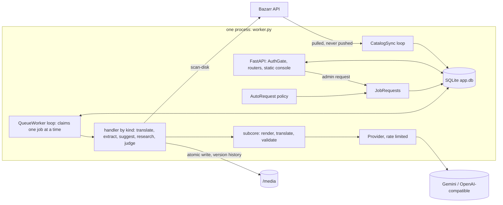

# Architecture

> The system as built. Written for someone who is about to change it: where a thing lives, what may call what, and
> which rules the code keeps. The target design and the reasons behind big choices are the ADRs in
> [design/ARCHITECTURE.md](design/ARCHITECTURE.md) (what to build: [design/SPEC.md](design/SPEC.md); the order of
> the work: [PLAN.md](../PLAN.md)). When this file and an ADR disagree about code that exists, this file is right.
>
> Kept in step with the code by `scripts/doccheck.py` (run with `ci-check`): every module of `subserver/` is named
> here as `<name>.py` (a module inside a sub-package with its folder, `store/auth.py`), every module of
> `packages/subcore` as `subcore.<module>`, and every `/api/*` route is in [API.md](API.md). That is a floor: the
> sections below say how the modules fit.
>
> Words with a fixed meaning (translation job, version, quota pause, ...) are in [CONTEXT.md](../CONTEXT.md);
> HTTP endpoints in [API.md](API.md), settings in [CONFIGURATION.md](CONFIGURATION.md), screens in
> [design/UX.md](design/UX.md).

## 1. The system in one page

One container, one Python process, one port (`6789`, ADR-4). It reads Bazarr's library, translates the missing
subtitles with a model, writes them beside the media and serves the console that drives all of it.

Three independent pieces (Bazarr pushes nothing, ADR-10):

1. The worker **pulls** the library into the catalog cache. A read never makes a job; jobs come from an admin's
   request (`job_requests.py`) or the `auto_request` policy (`auto_request.py`).
2. `apps/server/worker.py` and `subserver/` consume the queue one job at a time, translate in process with `subcore`,
   write the target `.srt` and ask Bazarr to rescan.
3. `apps/web` is the React console. It talks only to the worker's own `/api/*`; the worker serves its build.

Repository (a uv workspace; `apps/web` is not a member, it has its own `package.json`):

| Path | What |
|---|---|
| `packages/subcore/` | the engine library (`src/` layout): pure of Bazarr, queue, HTTP and the worker's database (ADR-2) |
| `apps/server/` | `llm-subtitle-server`: `worker.py` (the composition root), `subserver/` (the layers below), `tests/`; not packaged |
| `apps/web/` | the React console (TypeScript, Vite, Mantine, React Router in hash mode, TanStack Query, Vitest) |
| `docs/` | this file, `API.md`, `CONFIGURATION.md`, `openapi.json` (generated), `design/` (target design, UX) |
| `scripts/` | `doccheck.py`, `preview.ps1`, `start-local.ps1`, `fake_bazarr.py`, `smoke/` |

The image installs only `llm-subtitle-server` (which depends on `subcore`) and keeps the old runtime layout
(`/app/worker.py`, `/app/subserver`); the console build is `/app/static`.

## 2. The layers of `subserver/` (ADR-18)

`subserver/` is five layer packages plus the composition seam. Every module belongs to exactly one layer and
`tests/test_core_boundary.py` checks the direction of imports:

| Package | Holds | May import |
|---|---|---|
| `domain/` | pure decisions and the port types: `ports`, `config`, `queue_policy`, `rules`, `gather`, `suggestion_keys`, `subtitles`, `translation`, `redaction` | `subcore` and the standard library |
| `services/` | the use cases: `units`, `console`, `library`, `versions`, `memory`, `suggestions`, `judge`, `metrics`, `cleanup`, `catalog*`, `job_requests`, `auto_request`, `glossaries`, `styles`, `style_service`, `proposals`, `research`, `feedback`, `estimates`, `bootstrap`, `auth` | `domain`, `jobs`, the `Store` and the `Telemetry` sink; never another adapter, `api`, a socket or an HTTP client |
| `jobs/` | the queue and what runs a job: `jobs` (`JobStore`), `queue` (`JobQueue`), `provider_guard`, `read_jobs`, `translation_attempt`, `intake` | the same as `services/` |
| `adapters/` | what touches infrastructure: `bazarr`, `tmdb`, `http`, `gemini`, `llm`, `redirects`, `backups`, `connection_tests`, `settings`, `logs`, `bodies`, `telemetry` and the `store/` package | `domain` and other adapters; never a use case or `api` |
| `api/` | the FastAPI app and the routers | everything below, but never the `Store`, `JobQueue` or `JobStore`: a route asks a service |
| `runtime.py` | `RuntimeContext` and `BackgroundLoop`; with `worker.py`, the composition root | any layer |

`services/` and `jobs/` are really one tier: the job handlers use `services` (`library`, `memory`, `versions`,
`proposals`) and `services` use `jobs.queue`. The checked boundaries are the one below (`domain`) and the one
outside (`adapters`, `api`).

**Where a new file goes.** A pure function or a type that crosses layers is `domain/`; a class a route or a job calls
to do something is `services/`; code that runs a kind of job is `jobs/`; a module that opens a socket, a file the
worker does not own or a model provider is `adapters/`; a route is `api/`. A module that fits none of these fails the
boundary test. There are no alias modules at old paths.

**The `Store`** (`adapters/store/`) is a facade over one mixin per group of tables. `store/base.py` holds the
connection, the lock and the migrations runner, `store/migrations.py` the schema scripts, and one mixin each:
`store/auth.py`, `store/bundles.py`, `store/settings.py`, `store/records.py` (calls, events, signals, prompt bodies),
`store/insights.py`, `store/versions.py`, `store/library.py` (series, units, corrections), `store/glossary.py`,
`store/suggestions.py`, `store/catalog.py`, `store/memory.py`; `store/__init__.py` assembles them into the one `Store`
the rest of the worker holds. A method goes in the file of the table it touches. SQLite is `DATA_DIR/app.db`, file
mode `0600`, versioned migrations; tests build it as `Store(":memory:")` with the real migrations (ADR-12: the
application's own database is not behind a port).

## 3. Module reference

### `domain/`

- `ports.py`: the ports (`MediaLibrary`, `Metadata`, `ProviderFactory`, the `Telemetry` sink) and the named types the
  `Store` returns. `tests/test_core_boundary.py` keeps a `dict` or `sqlite3.Row` from leaking out of it;
- `config.py`: the settings schema (defaults, validation, `SYSTEM_SETTING_KEYS` the console cannot write, the key
  fields), language normalisation, Bazarr language lists, and `model_for_task`, the one place that maps a task to a
  model (`translate` = `gst_model`; `extract` = `memory_model`; `summarize`, `research`, `judge`; each falls back to
  `gst_model`);
- `queue_policy.py`: pure retry, breaker, scheduling and daily-quota decisions; the state changes are made elsewhere;
- `rules.py`: merges the series glossary with an episode's corrections and the style layers and hashes the result (a
  different hash than the stored `glossary_hash` means stale);
- `gather.py`: gathers one `TranslationBundle` from the episode's rules, story memory and metadata (the worker's half of
  the bundle contract);
- `suggestion_keys.py`: the *identity* of a suggestion (kind, name or pair, `from`; case and spacing folded);
- `subtitles.py`: subtitle path mapping, local source scanning, `existing_target_subtitle`;
- `translation.py`: the failure classes the queue acts on (`ProviderUnavailableError`, `DailyQuotaExceededError`,
  `HardJobError`, `ContextGapError`) and `redact`;
- `redaction.py`: the one secret filter (known values plus secret shapes) used by the log formatter, events, prompt
  bodies and error text.

### `services/`

- `units.py` (`UnitService`): the Library, corrections, retranslation, versions, diff, revert, compare, judge and
  glossary pages' use cases; `library.py` knows units and statuses (and `Library.impact_units`, the one place that counts
  how many translations a change to the rules would make stale); `versions.py` (`TranslationVersions`) publishes with
  version history, backs up before overwriting and reverts;
- `console.py` (`ConsoleActions`): the queue use cases of the HTTP layer (retry, cancel, delete, stop, the snapshot, a
  job's spec, the layer report). It does not make jobs;
- `catalog.py` (`CatalogSync` the guarded read of Bazarr into `catalog_items`, and `CatalogPaths`, which finds a job's
  files again by Bazarr's id), `catalog_view.py` (`CatalogView`, the Library read model: the label of each (item,
  language) is derived on reading, never stored), `catalog_actions.py` (the Library page's use cases),
  `job_requests.py` (`JobRequests`: planning, estimate and creation of requests, `POST /api/jobs`), `auto_request.py`
  (`AutoRequest`, the policy), `bootstrap.py` (the first episodes `auto_request` may ask for while a series has nothing
  approved) and `estimates.py` (`Estimator`: what an action that spends model calls would cost, said before it runs;
  a Translate request's estimate also counts the fact reads its jobs would run first, `extract_calls`, through
  `StoryMemory.extract_needed`, which follows the same rule as `ensure_facts` and calls nothing);
- `memory.py` (`StoryMemory`): story order, prerequisite fact extraction, gap waiting, the context bundle and its
  staleness;
- `glossaries.py`, `styles.py`, `style_service.py`: the glossary, genre presets, series and episode styles and character
  cards in the database, and the use cases of the Style page, including the trial of a style (writes nothing);
- `suggestions.py` (`SuggestionService`), `proposals.py` (`FactsProposer`), `research.py` (`Researcher`),
  `feedback.py` (`FeedbackProposer`): proposals and the Review inbox (section 6);
- `metrics.py` (`Metrics`), `judge.py` (`JudgeService`): Insights and the optional judge (section 6);
- `cleanup.py` (`Cleanup`): file clean-up (FR-13);
- `auth.py` (`ConsoleAuth`): the single console account (a scrypt hash in the `auth` table, sessions, Basic Auth).

### `jobs/`

- `jobs.py` (`JobStore`): the `jobs` table; every state change of a job is a method here (claim, wait, finish, stop,
  retry, delete of a finished row);
- `queue.py` (`JobQueue`): the lifecycle: recovery, settling, claiming, deferred retries, quota pauses and status
  persistence; it decides, `JobStore` stores;
- `provider_guard.py`: what every job that calls the model shares: the time limit, the call budget (`JobProviders`), and
  `mapped_errors`, the one place a provider's typed failure becomes the queue's class;
- `read_jobs.py`: the handlers of jobs that read and do not translate (`ExtractJob`, `SuggestJob`, `ResearchJob`, `JudgeJob`);
- `translation_attempt.py` (`TranslationAttempt`): the only place that translates through `subcore` (section 5);
- `intake.py`: the one-time settling of an older queue (folders and the P8 rows) at start-up.

### `adapters/`

- `bazarr.py` (`BazarrMedia`, the `MediaLibrary` adapter: catalog read, refresh, wanted-item lookup, key parsing),
  `tmdb.py` (`TmdbMetadata`), `http.py` (a small HTTP client and JSON file cache helpers), `redirects.py`
  (`RedirectResolver`: follows the redirect link of a grounded Gemini answer one hop to the page's own address; only
  Google's redirect host is ever fetched);
- `llm.py`: builds the provider of an attempt: one rate-limited provider per API key with failover. `LiveProviderFactory`
  takes the usable keys from `SettingsService` at every build, so a new key is used by the next call, and wraps each in
  `KeyedProvider`, which reports a refused key (`AuthError`: the key becomes `invalid`), a use and an unknown model
  (`ModelNotFound`: a Settings warning) back to the service. `build_provider` is the plain function over a settings
  mapping; `gemini.py` and `connection_tests.py` serve the Settings "Test" buttons and the model pickers;
- `settings.py` (`SettingsService`): the console settings and API keys in SQLite (P6): one-time import of `config.json`,
  one-time seeding of keys from the environment, precedence stored value > environment > default, the masked public
  view, subscribers told of every change, the warnings Settings shows;
- `backups.py`: backup listing, creation and restore (no key unless a manual backup asks; a restore never touches the
  `auth` table);
- `logs.py`: logging setup, UTC formatting with secrets removed from every line (`RedactingFormatter`), a log level that
  can change while running, 5 MiB rotation (three backups);
- `telemetry.py` (`Telemetry`): the bounded queue and single writer thread behind events, quality signals and call
  records; `bodies.py` (`BodyLog`): the rotating JSONL files with the prompt and answer of each call;
- `store/`: see section 2.

### `api/`

- `web.py`: `create_app` builds the FastAPI app from the runtime context (the gate, every router, the sign-in page, the
  static files as the last route, the `lifespan` that starts the loops); `start_web_server` runs it with uvicorn;
- `security.py` (`AuthGate`): a pure ASGI middleware in front of every path (routes, fallback, static files): a session
  cookie or Basic Auth, the login lockout, the same-origin check on cookie writes, a re-issued session cookie on the way
  out. The only open requests are `GET /login` and `POST /api/auth/login`;
- `common.py`: what routes share: the JSON answer and the `{"error": ...}` shape, `ConsoleRoute` (a `ValueError` is a
  400, anything else a logged 500), `blocking` (synchronous work runs on the thread pool, never on the event loop) and
  `add_table_routes`, which gives each row of a pure router's regex table a real FastAPI route;
- `auth_api.py` and `console_api.py`: the routes that are not a page's table (the account; status, queue buttons,
  settings, languages, models, logs, events, backups, clean-up, connection test);
- page routers, each a regex table plus a pure `handle` and a `register`: `library_api.py` (`/api/library/*`,
  `/api/units/*`, `/api/series/*`), `catalog_api.py`, `style_api.py`, `suggestion_api.py`, `insight_api.py`, `keys_api.py`;
- `schemas.py`: pydantic models of request bodies (unknown fields pass; a flag that makes a call spend is `StrictBool`; a
  body no model names is `RequestObject`, which the use case validates). A body that does not fit is a `400
  {"error": "field: reason"}`; the body is read as JSON whatever its `Content-Type`;
- `answers/`: the pydantic model of what each route **answers**, one module a page: `answers/common.py` (the
  confirmation, a request's price, the count of what a change would flag stale, the error), `answers/console.py`,
  `answers/catalog.py`, `answers/library.py`, `answers/style.py`, `answers/suggestions.py`, `answers/insights.py`. A model
  is a contract and is not run: a route keeps sending what its use case returned, and `response_model` (or the `ANSWERS`
  table of a pure router) only puts the model in the OpenAPI document. `Answer` forbids a field it does not name,
  `OpenAnswer` ignores one (a job is a stored payload); `maybe()` marks a field the answer may leave out;
- `openapi.py`: exports the OpenAPI document from the routes alone (no server, no database) to `docs/openapi.json`, which
  is committed. `apps/web` generates `src/api/schema.gen.ts` from it.

### `runtime.py` and `worker.py`

`worker.py` is the runtime entrypoint and the composition root: it builds the adapters (`Store`, `JobStore`,
`BazarrMedia`, `TmdbMetadata`, the HTTP client), passes them down as ports, and holds `process_job` and `QueueWorker`.
It imports no socket, SQLite or HTTP-server module itself. `RuntimeContext` (`runtime.py`) is the typed composition seam
of the running process; new wiring depends on its fields. Three `BackgroundLoop`s (the queue worker, the catalog sync, the
backup and clean-up scheduler) are handed to `start_web_server` and started on daemon threads in the app's `lifespan`
(`--worker-only`, which has no console, starts them from `main()`; `--no-worker` leaves the queue loop out, `--no-queue`
keeps it from claiming). There is no `BackgroundTasks` and no other background mechanism (D7).

## 4. How a request and a job travel

**An HTTP request.** `AuthGate` (ASGI, first) -> a route of the FastAPI app (a body is validated by its `schemas.py`
model) -> the route calls a use case on the thread pool (`common.blocking`) -> the use case reads or writes through
`Store`, `JobStore` and the ports -> the answer is sent as the use case returned it. A route parses, calls and formats;
queue and job-building logic belongs in `services/console.py` (or the page's service), not in a route. A new route is a
row of a table or a function in `console_api.py`, a model in `schemas.py` / `answers/`, a line in `docs/API.md` and a
case in `tests/test_answer_contract.py`.

**A job.** A translation of a missing language is requested by exactly two deciders: an admin's request (`JobRequests`,
origin `manual`, interactive class) and the policy (`AutoRequest`, origin `policy`, automatic class). The other jobs are
queued by `JobQueue` helpers under an admin's own action or a finished job: a retranslation (origin `retranslate`), a variant
(`variant`), extract facts, research terms and judge (`manual`), a put-back of a failed job (`retry`), and the `suggest` and
`research` jobs that `TranslationAttempt` queues after a job settles (`facts`). A read of Bazarr and a GET never make one. It is a row of `jobs` (states `queued`, `running`, `waiting`
with a `wait_reason` of `quota`, `provider`, `context`, `settle` or `rate`, `done`, `skipped`, `failed`, `cancelled`).
`QueueWorker` claims one at a time (priority by class, round-robin over series, aging) and `run_job` runs it by `kind`
through the handlers `worker.py` registers (`register_handler`):

| `kind` | What it does | Handler | Key |
|---|---|---|---|
| `publish`, `variant` (`TRANSLATING_KINDS`) | translate a subtitle; `variant` always ends as a `candidate` | `translate_job` -> `TranslationAttempt` | a sha1 of source path, output path and target code (a variant and a retranslation hash a prefix too) |
| `extract` | the facts of one episode | `ExtractJob` | `extract:<unit_id>` |
| `suggest` | proposals for one series and language, at most three calls | `SuggestJob` | `suggest:<series>:<lang>` |
| `research` | the names and terms of one series looked up on the web, two calls (a search, then a read of its answer) | `ResearchJob` | `research:<series>:<lang>` |
| `judge` | the LLM judge on one candidate, 30 cues a call | `JudgeJob` | `judge:<unit>:<lang>:<version>` |

`READING_KINDS` read and have no subtitle, no bundle and no strong model. Every task that spends model calls is a row
of `jobs` and goes through the one queue, so the day's quota, `max_calls_per_day`, the breaker, Stop and a restart
apply to all of it. A handler does its work and lets typed provider errors through `provider_guard.mapped_errors`; it
takes its providers from `provider_guard.JobProviders` (deadline, `max_calls_per_job`, `max_calls_per_day`, one provider
per model). The admin's request only queues; `estimate_only` stays synchronous because it spends nothing. Every reader of
jobs says which kinds it means (`job_name`, `latest_for(kind=)`, `layer_report`, `catalog_view`, `_hard_job`,
`estimate_retry`); a new kind is added to that list with a test.

The old folders `pending/ processing/ deferred/ done/ failed/ held/ rejected/` are read once, at start-up
(`intake.import_queue_tree`), and moved to `queue.migrated/`: `processing`/`deferred` become jobs, `done`/`failed` the
history, a `held` job is dropped (the item is Missing again), a `rejected` one becomes an Ignored decision
(`unit_decisions`), and `pending` (what the old Bazarr script dropped and nobody approved) is not run: those items are
Missing again and the start-up logs how many. A "no" is written down before the row or folder that held it goes; one that
cannot be written yet stays, with its folder, and is tried again at the next start-up. Running it again changes nothing.

Job fields are the `jobs` row (`jobs.py` has the columns). `gst_model` is the model of the latest attempt;
`use_fallback_model` marks a job handed to the strong model after an outage or a hard job (`escalated_from`,
`escalation_reason`); a finished job records its `result` (`translated`, `skipped`, `skipped-not-wanted`, ...); `trigger`
is `auto`, `retranslate` or `variant`.

## 5. Translating

The Bazarr half: `CatalogSync` reads the library through `MediaLibrary.catalog()` (series paged, their episodes, movies
paged, their subtitles and the languages Bazarr lists as missing) and applies the answer only when it is whole and
plausible (section 8). `BazarrMedia` also asks Bazarr to rescan after a write.

A translation job, in `TranslationAttempt` (`translation_attempt.py`, the only place that translates through `subcore`):

1. The oldest ready job is claimed. A job is dropped, with no model call, unless its language is still missing
   (automatic jobs): the exact target file or any sibling subtitle in that language exists, the folder is outside
   `GST_ONLY_PATHS`, or Bazarr no longer lists the language in `missing_subtitles` (`skipped-not-wanted`; if Bazarr
   cannot answer, the files decide). The same checks run when the job is requested, so most never enter the queue.
2. TMDB context is built when a key is set. An attempt refuses a variant when it has no version history or no library, and
   masks the free text (overview, title, story sections) before the bundle is gathered.
3. If the store already holds a result for the same source sha256, target language and context hash (model,
   temperature, prompt version, TMDB description), the stored copy is published and no model call is made.
4. Otherwise `subcore` translates with the model the queue chose: the default `gst_model` (a light model), or the strong
   `gst_fallback_model` when the job was handed over or the default model's daily quota is spent. Every call goes through
   a rate limiter (RPM/TPM/RPD) and retries `429`/`503` with exponential backoff, jitter and `retry-after`; calls time out
   after 300 seconds and a job has a 30 minute watchdog (`JOB_TIMEOUT_SECONDS`). Progress reaches the queue through the
   status callback (`progress_done`, `progress_total`). A failed attempt starts again from the beginning: only a finished
   result is kept.
5. Provider failures are typed exceptions, never parsed text. A `503` or rate limit that outlasts the in-process retries is
   counted by a breaker per model (`queue_policy.py`): the first two consecutive failures make the job `waiting` (`rate`)
   for 30 seconds; the third (`breaker_threshold`) opens the breaker, which rests 5 minutes and, each time a trial fails,
   15, 30, then 60. When the breaker opens and the other model is usable the job is requeued on it at once; otherwise it
   waits (`provider`) until the rest ends, and no job needing that model starts meanwhile. A provider outage does not fail
   a job. `AuthError` marks the key
   `invalid` and passes over it (the next call uses another key if there is one); an unknown model (`ModelNotFound`) is a
   Settings warning; an exceeded watchdog fails the job. Output that stays invalid after repair and splitting
   (`HardJobError`) is a hard job and moves once to the strong model, recording `escalated_from`.
   `layer_report` (`/api/status` `model_layers`) counts how many escalate and how many the strong model finishes.
6. A daily quota error pauses that model for 24 hours; another configured model with quota continues the job; when every
   model is spent, the job and the waiting jobs wait for the first pause to end.
7. On success the result is written atomically, recorded as a version and the job is `done`; Bazarr is asked to
   `scan-disk` (item ids missing: the full subtitle scan tasks).

**Versions.** The `Store` keeps every version published for a target path with its sha256, input hash and a copy under
`DATA_DIR/backups/subtitles/`. A target file is *system-made* when the current version for its path has the file's sha256.
An automatic job never overwrites an existing target. A retranslate, cue edit or revert first keeps a file that is not the
current version (a hand edit, or one someone else put there) as an `external` version, then writes atomically. Reverting
restores a stored version byte for byte and records the restore as a new version. A result that cannot go on disk safely
(the file appeared during the job, the base version moved, the source changed) is a `candidate`; only "Use this version"
publishes it. Publishing is announced before the rename (`publishing`) and settled at start-up
(`TranslationVersions.reconcile`).

**The prompt.** One function composes a request (`subcore.translate.engine.compose_request`, for `run` and
`render_requests`), from a `TranslationBundle`. Sections, empty ones left out: core rules; target-language rules (`vi`
address guidance); glossary ("Authoritative: these rules override anything inferred from context"; the *Terms* part is
filtered per request by `subcore.matching` above `glossary_filter_threshold`, `address_rules` and character cards are
not); effective style (the glossary still wins); character voices (cards the dialogue names, or `always`); episode
corrections and story-memory sections; metadata; few-shot examples (`"source" -> "fix"`, chosen within a token budget).
The model never sees an index or timecode: `i` is the 1-based number of the cue in the parsed list; a cue keeps its
original index and timing line, so output reproduces timecodes byte for byte; empty cues are not sent. A reply is
validated cue by cue; missing cues get one repair call with only those cues and five neighbours (twice at most), then the
planner splits into more parts (`max(2, 2 x parts)`), then the job is hard. Locked-term violations go through repair
too; if the model still refuses after two rounds the translation is kept with a warning, not failed. A cue run shifted by
2-4 cues (the model gave every `i` the wrong text) is caught by `subcore.translate.alignment` (anchors and a length
correlation window) and repaired the same way; a leftover is a warning.

## 6. Subsystems

### Library, corrections and retranslation

A *unit* (an episode or a movie) is registered the first time a job for it runs (identity from Bazarr ids, then the file
name). `units`, `series`, `unit_outputs(unit, language) -> path`, `corrections` and a `unit_id` and `glossary_hash` on every
version live in `app.db`. `rules.py` merges the glossary with the unit's active episode corrections and style layers;
terms and address rules carry `from`/`until` windows (`until` exclusive; timecodes are turned into cue numbers before they
reach the prompt). Hand-edited cues (`cue_edit`) are outside the hash: they are locked output, and so are few-shot examples
made from them (a cue edit must never flag a series stale, ADR-14 point 9). `Library.impact_units` is the one place that
counts the stale translations a change would cause; every save, restore, copy, adoption or deletion that changes a hash
asks it first and answers `stale_now`, `stale_after`, `would_stale` (`dry_run` only counts). A glossary change counts one
language; a style, card, preset or an episode's style counts every language.

A retranslation is a job (`trigger: retranslate`, priority 100, `retranslate.range`, `retranslate.correction_ids`); the
attempt asks `subcore` for the range only (`only=`), passing locked cues and the current translation of cues outside the
range as `keep=`, copied verbatim and shown to the model as reference. A retranslated range is stamped with the hashes of
the whole episode. The trial of a style (`StyleService.preview`) writes nothing; a `variant` job ends as a `candidate` and
ignores an existing target.

### Story memory (P4)

`subcore.memory` is pure: `subcore.memory.facts` reads the *facts* of one unit from its source subtitle (characters,
relationship changes with the cue where they show, terms, a summary; structured output, nothing but the numbered text is
sent), `subcore.memory.fold` folds the facts of the units before N into the *story state @N* and renders the prompt sections
("Story so far", "Relationship state", "This episode"), `subcore.memory.compress` condenses old summaries with one model
call. Facts come from source subtitles, never from translations, and are immutable: a correction layers over them in the
glossary and is never lost by re-extraction.

`memory.py` (`StoryMemory`) decides which facts a unit sees. Story order is `(season, episode)` as Bazarr numbers them;
season 0 sits outside the chain and sees the state after `series.specials_after` (default: the end of season 1). Before a
unit is translated `plan()` asks Bazarr for the series' episodes and registers them; reads the facts of each earlier unit
whose source exists and has none stored for that sha256 and `EXTRACT_PROMPT_VERSION` (stored facts are kept when the source
has gone; a unit with neither is a *gap*); while there is a gap and `memory_gap_wait_seconds` has not passed raises
`ContextGapError` (the queue defers the job, `wait_reason: context`, rechecked every 5 minutes; a retranslation does not
wait); then builds the bundle (older summaries are condensed by one `summarize` call cached in `summaries_cache` if the
story exceeds `memory_budget_tokens`). Prerequisites run inline in the same attempt (one job at a time), not as separate
jobs; `extract` jobs exist for the admin's own "extract facts" request. Relationship events with `confidence < 0.3` are
ignored; a pair's last event wins (later unit, then later cue); an event under 0.6 does not flip a relation at 0.9 or more.

The bundle's *fingerprint* (hash of the label and content hash of every earlier unit's facts plus the unit's own) is stored
as `translations.memory_hash` and the rendered text in `context_snapshots`. A version is `stale` when the rules hash
differs, when the fingerprint from the stored facts differs, or when a unit in `missing_units_json` now has a source. "Facts
of a unit" is always the newest stored facts for the current `EXTRACT_PROMPT_VERSION`, for building a bundle and for
checking staleness alike; keep it that way. A version made with memory off never goes stale for memory. Memory is off unless
`memory_enabled` or the series says `on`.

### Suggestions and the Review inbox (P13, P14)

One table (`suggestions`), one use case. `SuggestionService` (routes in `suggestion_api.py`, in
`RuntimeContext.suggestions`) is the only place that stores a generator's proposals (`propose`), decides them (`accept`,
`reject`, `undo`, `bulk`) and applies them; a generator hands it a list of `Proposal`s and has no review logic of its own.
Generators: `proposals.py` (`FactsProposer`: address rules and terms from facts, characters from memory; `subcore.suggest` is
the pure part, one `extract`-task call per kind returning target-language forms, no timecode to the model; reached through a
`suggest` job), `feedback.py` (`FeedbackProposer`, over `subcore.feedback`: a swap of words repeated in three or more
corrected cues becomes a `term`, no model call, must never raise into a cue edit), and research grounding (`research.py`, below).
Accepting goes through `Glossaries.save_doc` (and `write_character` when a character carries its voice, in one
transaction) and counts the stale translations with `Library.impact_units`; it never retranslates. Undo restores exactly
what an accept replaced and refuses when the entry changed since. A decided suggestion is kept (a few bytes) and never
cleaned up: the **identity** of `suggestion_keys.py` is why the same entry is not proposed again; the content fingerprint
stays only as the unique key. `auto_accept_*` goes through the same `accept`; a `term` is applied by itself only with two
independent sources (`suggestions.source_host`, the registered domain), an address rule or character only when its own
switch is on (FR-4.4); a proposal with no research `sources` is never applied by `auto_accept_terms`. What the inbox holds in
any status, and what the model recently had no answer for (`suggestion_skips`, `SKIP_DAYS`, per prompt version), is taken out
of the candidates *before* each kind's limit. `FactsProposer.run` stores each kind as soon as it returns and lets a provider
error propagate typed. `TranslationAttempt` calls `after_facts` once the job is settled and only queues a `suggest` job
(origin `facts`, the lowest class); it must never raise into the job. `bootstrap.py` says whether a series is held back
(`is_locked` is pure), asked by both `AutoRequest` and `CatalogView`.

**Research grounding (P16, FR-7).** `subcore.research` asks twice, both calls for the `research` task: a search call (the
provider's search tool on, no schema, `research_model`) and a call that reads its prose into `[{i, target, source_refs}]`
(structured output, the `extract` model). The pages a proposal rests on are the provider's grounding metadata
(`LLMResponse.grounding_sources`, with `cited_text`: the answer with a `[n]` after each passage a page backs); a link the model
writes is never a source, and an answer with no page behind it proposes nothing. Gemini's pages come as redirect links of
Google's whose title is the site's domain, so `Researcher` follows each link once (`RedirectResolver`, behind the
`LinkResolver` port) and keeps the page's address, or the site's name as an address when that fails; `source_host` then counts
independent sites correctly. `Researcher` (`research.py`) is the one place that gathers the candidates (the terms two or more
episodes share, minus the glossary, the inbox in any status and what the web had no form for in the last `SKIP_DAYS`; the skip
identities are its own, `research_term`), keeps the budget, and hands `SuggestionService.propose(source="research")` the
result; there is no other way into the glossary. It is a job of its own (`research`, key per series and language): the
hook `FactsProposer.after_facts` calls `Researcher.after_facts`, which, when `research_enabled` is on, the provider is Gemini and
the series has terms and budget left, queues one at origin `facts` and above every translation (`AUTO_PRIO`), whatever
`auto_request` says; it never raises into the translation. `research_max_calls_per_series` counts the `research` calls of the
series from `llm_calls.series_id` (migration 16, written by `ResearchJob` through `Telemetry.llm_call(series_id=)`), so the
count survives the clean-up of finished jobs; a run stops before the call that would pass it, ends `done` with the event
`research.budget_reached`. A provider with no search tool (`openai_compat`) queues nothing and a run made anyway is `skipped`.
A search that runs out of quota or cannot be reached makes only the research job wait (`JobQueue._research_waits`, reason
`rate`): the health of the translation model is not touched, so a limit of the search never rests the translations.

### Insights, the golden set and the judge (P15)

`Metrics` (`metrics.py`) is the one place that works out the figures of FR-19.5. It rolls the raw records (`llm_calls`,
`quality_signals`, `translation.finished` events) into `metrics_daily` (per UTC day, name and labels, rolled again from the
last roll-up, never for a day the events clean-up has begun to prune) and the report only adds those rows, so a figure
outlives its events; a rate with nothing to divide by is `None`, never 0. A corrected cue is blamed on the prompt version of
the job that wrote it. A cue edit keeps the machine's text as `before_text`, inherited through later edits of the cue; only
the golden set (`subcore.golden`, scored by `subcore compare --golden x.json`) reads corrections without it. Routes:
`insight_api.py` (`/api/metrics`, `/api/series/{id}/golden`, `RuntimeContext.insights`), and `POST /api/suggestions/from-edits`.

The LLM judge (FR-18.8) is advice, never a verdict. `subcore.judge` is pure (the rubric, the request, the parse; which text
is shown first is a fixed function of the cue number, `variant_is_a`; an `A`/`B` is mapped back to `variant`/`current`/`tie`
and an entry that is not what was asked is dropped). `JudgeService` (`judge.py`, `UnitService.judge`) is the one place that
queues (`request`, the interactive class, `estimate_only` for the price), runs (`run`, called by `JudgeJob` under
`mapped_errors` and `JobProviders.for_task("judge")`) and reads (`annotate`, laid over `UnitService.compare`). A verdict is a
`judge` quality signal bound to the exact pair of texts it saw, the candidate version and `JUDGE_PROMPT_VERSION`; it is never
an `ab` signal (`Metrics` reads only the admin's), never a cue edit and never starts a retranslation. Each batch is stored
when it returns. Off by default (`judge_enabled`); the runtime settings carry the switches of suggestions and the judge, so a
switch turned off in the console reaches the running worker.

### Logging and measurement (P5)

Three kinds of trace, in `app.db`, plus prompt bodies in files (FR-19, ADR-15). Core code reaches them through the
`Telemetry` port (`event`, `signal`, `llm_call`); `telemetry.NULL` is the default wherever it is optional and `worker.py`
builds the real one over the `Store` and a `BodyLog`.

- **Events** (`events`): a decision with its reason (`enqueue.skipped`, `job.created`, `catalog.synced`, `catalog.kept`,
  `request.created`, `policy.requested`, `policy.capped`, `job.claimed`, `model.selected`, `job.escalated`, `job.deferred`,
  `job.requeued`, `job.skipped`, `job.failed`, `job.done`, `quota.paused`, `translation.cached`, `translation.finished`,
  `version.published`, `version.reverted`, `version.cue_edit`, `settings.changed`, `worker.started`, ...). `GET /api/events`
  reads them. Each is also a log line (`EVENT {...}`), so the log level also decides which events are kept.
- **Call records** (`llm_calls`): one row per provider attempt with the prompt version, glossary hash, kind (translate,
  repair, split), batch, HTTP status, finish reason, attempt, cues repaired and an estimated cost.
- **Quality signals** (`quality_signals`): `cue_edit`, `revert`, `retranslate`, `validate`, `ab` (the admin's pick) and
  `judge`.
- **Bodies**: `DATA_DIR/logs/llm/<day>.<n>.jsonl`, gzipped when closed; `llm_bodies` indexes `(call, segment, offset,
  length)` and keeps the row (marked `rotated`) after clean-up removes the file.

`Telemetry` never raises and never waits: records go into a bounded in-memory queue read by one writer thread, outside any
job transaction; a full queue or failed write drops the record, counts it (`dropped`, shown by `/api/events`) and warns now
and then (NFR-11). The same thread prunes events past `events_retention_days` and body files past `log_retention_days` and
`log_max_mb`. Every text passes the shared redactor first.

### Settings, keys, authentication, clean-up

Settings live in the `settings` table (DB > environment > default) and are live without a restart: `SettingsService` tells
its subscribers (the worker's `apply_settings`) after every change. Process-level configuration (paths, port, console
account; `SYSTEM_SETTING_KEYS`) comes from the environment only. API keys live in `api_keys`; the environment seeds them on
the first run only. The model provider is the setting `llm_provider` (`gemini` or `openai_compat`, with `llm_base_url`), not
a property of a key; `subcore.providers.openai_compat` is standard library only, never follows redirects, and degrades
structured output by capability (schema, JSON mode, prompt only) while the engine's validator stays the judge.

Authentication is `AuthGate` over `ConsoleAuth`; the account is a scrypt hash in the `auth` table, seeded from
`CONSOLE_USER`/`CONSOLE_PASSWORD` on the first run (the stored account wins afterwards; `CONSOLE_PASSWORD_RESET=1`
overwrites it); `CONSOLE_AUTH=off` is the only opt-out. Five wrong sign-ins from an address lock it for five minutes.

`Cleanup` (FR-13) never touches a media folder: it deletes through the owners of what it deletes (`JobStore.delete_expired`,
`TranslationVersions.prune`, `Glossaries.prune_history`); its temporary-file sweep skips every media root and the folder of
every target subtitle and only lists what it finds there. It previews unless asked `dry_run: false`; `0` in a `retention_*`
setting switches its group off. A version whose copy went is `pruned`: the line stays, `revert` and diff refuse it with the
reason, and nothing may read its `stored_path`.

## 7. The engine: `subcore`

`packages/subcore` is pure of Bazarr, the queue, HTTP and the worker's database (`tests/test_core_boundary.py` and the
package's own tests keep it so). Modules:

- `subcore.srt`: parse and serialise SRT;
- `subcore.bundle`: `TranslationBundle`, everything one translation reads, as plain data (the worker builds it in
  `gather.py`, the CLI loads it with `--bundle`; the same bundle gives the same prompt);
- `subcore.glossary`: the glossary model (terms, characters, address rules), its YAML exchange format, merging and the
  locked-term check; `subcore.style`: the style layers and `resolve_style`; `subcore.matching`: the one place that decides
  whether a line mentions a name; `subcore.fewshot`: examples chosen from corrected cues;
- `subcore.translate.planner` (how many parts a unit is translated in), `subcore.translate.prompt` (the system and request
  text), `subcore.translate.engine` (`run`, `render_requests`, `compose_request`: batches, repair, splitting, the review
  pass), `subcore.translate.validate` (parse and check a reply), `subcore.translate.alignment`, `subcore.translate.review` (a
  finished translation against its source: `validate` and the worker share it);
- `subcore.providers.base` (the `Provider` interface and the typed errors: `RateLimited`, `QuotaExhausted`, `Unavailable`,
  `BadOutput`, `AuthError`, `ModelNotFound`), `subcore.providers.gemini`, `subcore.providers.openai_compat`,
  `subcore.providers.fake` (deterministic, for tests and dry runs) and `subcore.providers.limiter` (`RateLimiter`,
  `ResilientProvider`: RPM/TPM/RPD windows, retry with backoff, key failover);
- `subcore.memory.facts`, `subcore.memory.fold`, `subcore.memory.compress`; `subcore.suggest`, `subcore.feedback`,
  `subcore.research`, `subcore.golden`, `subcore.compare` and `subcore.judge`;
- `subcore.cli`: the `subcore` command (`translate`, `bundle`, `render-prompt`, `validate`, `compare`); it knows no
  database, queue or HTTP. A bundle's `params.model` empty and `max_output_tokens` 0 mean "decided by the provider that runs
  it": they are neither serialised nor hashed; the worker always sets both.

## 8. The console

`apps/web` (ADR-17): TypeScript (strict), Vite, Mantine, React Router in hash mode (it runs in an iframe of Organizr on an
iPad), TanStack Query, Vitest. It calls only `/api/*`, is English-only, touch-first (targets >= 44 px, no hover-only
controls), portrait first (about 820 px; landscape >= 1024 px only widens tables and grids) and has no CDN dependency. The
Dockerfile builds it in a pinned Node stage and copies only `dist/` into the final image as `/app/static`; the final image
never holds Node, `node_modules` or the sources. The sign-in page `apps/web/public/login.html` is the one file outside the
bundle (self-contained, `GET /login`, the only static file served without a session). The code is organised as `api/`
(typed calls and queries; `schema.gen.ts` generated from `docs/openapi.json`, `types.ts` names the generated types the
screens use, `route.ts` builds a URL from a route of that document so a wrong path parameter or query name does not compile), `lib/` (pure rules, tested without a DOM; `settings.ts`, `draft.ts`), `components/` (the price box,
confirmation sheets, the style form) and `pages/`. A page never builds HTML from text: React escapes it, and paths and
provider errors are untrusted. Screens, data and layout: `docs/design/UX.md`.

## 9. Data and paths

The tables, by group (the schema is `adapters/store/migrations.py`; a table is read and written only by the mixin of its
group): `auth`; `settings`, `api_keys`; `jobs`, `provider_health`; library (`series`, `units`, `unit_outputs`,
`unit_decisions`, `corrections`) and catalog (`catalog_items`, `catalog_state`); versions (`translations`); glossary (`glossaries`,
`glossary_history`, `style_profiles`, `character_cards`); memory (`facts`, `summaries_cache`, `context_snapshots`);
`suggestions` (and `suggestion_skips`); records (`events`, `llm_calls`, `llm_bodies`, `quality_signals`); insights
(`metrics_daily`); `job_bundles`. A state shown to the admin (Missing, Requested, Translated, Edited, External, Removed, Stale,
Failed, Ignored) has no column: Library works it out when reading from `catalog_items`, the versions, the jobs and the
decisions (FR-14.5).

Bazarr and the worker must see identical media paths. The recommended model is `- /host/media:/media`: if Bazarr sees
`/media/Movie/Movie.en.srt`, the worker must read and write that exact path in its container. Default container paths:
`/state`, `/media`, port `6789`; `/queue` is only read once at start-up.

## 10. Seams

Rules for where code attaches. Enforced where a test is named.

- `RuntimeContext` is the composition seam: new runtime wiring depends on its typed fields; the module-level functions are
  compatibility entry points for older callers and tests.
- `queue_policy.py` holds pure scheduling, breaker and quota decisions; state changes stay in `JobStore`, the lifecycle in
  `JobQueue`. The HTTP layer reaches the queue only through `ConsoleActions` (and the Library's requests through
  `CatalogActions`). Queue recovery runs explicitly at worker start-up; creating a `JobQueue` handle must not recover
  in-flight work.
- `TranslationAttempt` is the only place that translates through `subcore`. Typed provider errors (`QuotaExhausted`,
  `RateLimited`/`Unavailable`, ...) become the queue's `DailyQuotaExceededError`/`ProviderUnavailableError` only in
  `provider_guard.mapped_errors`, which every kind of job uses; never classify a failure by parsing error text.
- Core modules reach Bazarr and TMDB only through the `MediaLibrary` and `Metadata` ports (`domain/ports.py`);
  `worker.py` builds the adapters and passes them down, and stays free of direct socket and HTTP-server imports
  (`tests/test_core_boundary.py`). `subcore` never imports the worker.
- The application's own SQLite is not behind a port (ADR-12): core code takes `Store` (and `JobStore`) directly. Ports stay
  only for what the project does not own (`MediaLibrary`, `Metadata`, `ProviderFactory`) and the `Telemetry` sink. A new
  `Store` method goes in the file of its table and returns a named type from `ports.py`, never a `dict` or `sqlite3.Row`.
- The console is a FastAPI app served by uvicorn in this process. A route only parses, calls a use case and formats the
  answer; synchronous work runs on the thread pool through `common.blocking`, never on the event loop. A body has a model in
  `api/schemas.py`; an answer has a model in `api/answers/<page>.py`, declared on its route. The model only documents (a
  route still sends what its use case returned); a new route is not done until `tests/test_answer_contract.py` calls it (it
  starts the real worker on seeded data and checks each answer strictly against its model; its last test fails for a route
  with no model or no case). Answers are typed by generation: `docs/openapi.json` (`python -m subserver.api.openapi`) and
  `apps/web/src/api/schema.gen.ts` (`npm run gen:api`) are never edited by hand; a field a screen needs is added to the
  model and both are generated again. CI fails when either is out of date. Tests serve the app with `tests/web_harness.py`
  (`serve_console`) or `starlette.testclient.TestClient`.
- Library, corrections, retranslation, history and glossary pages reach the worker through `UnitService` and the pure
  router `library_api.py`. `TranslationAttempt` takes the `Library` so a job is registered and prompted with its rules.
  Retranslations are jobs with `trigger: retranslate` and `priority: 100`; `should_skip_job` lets them overwrite and
  their priority runs them before automatic jobs.
- `subcore.matching` is the only place that decides whether a line mentions a name (glossary filter per request, character
  cards present, locked-term check, console matches); a test fails if another module writes a word-boundary pattern. A
  request is composed only by `engine.compose_request`.
- Which model a task runs on is `config.model_for_task` (pure); new code asks it, never reads `memory_model` and friends.
- Keys are read through `SettingsService`, never from `os.environ`, a file or `config.json`; `subcore` receives a key only as
  an argument, and a key never crosses providers (`GEMINI_API_KEY`, `OPENAI_COMPAT_API_KEY`).
- Telemetry is a port: core code calls the `Telemetry` sink (`telemetry.NULL` when none is wired).

## 11. Invariants

What must stay true, whatever the change.

**Translations and files**

- A unit never sees the facts of a later unit (season 0 sits outside the chain). Facts come from source subtitles, never from
  translations. A stale translation is flagged, never retranslated automatically.
- An existing target subtitle is never overwritten by an automatic job. Only an explicit retranslation, cue edit or revert
  replaces it, and each keeps the previous file as a version first. A result that cannot go on disk safely is a `candidate`;
  only "Use this version" publishes it. Target subtitles are published only through `TranslationVersions`, which records each
  version in the `Store` and keeps a copy under `DATA_DIR/backups/subtitles/`; retranslate and revert back up a non-system
  file first. Only `manual` origin (or a retranslation) brings back a subtitle the admin removed.
- Only a missing language is translated: a sibling subtitle already in the target language (any name) or Bazarr no longer
  listing it ends the job with no model call. Real-Bazarr trials run with `GST_ONLY_PATHS` set and `auto_request` on for one
  series at a time; never point the worker at a whole library without that.
- Bazarr and the worker must see identical media paths (`/media/...`).
- Two model layers: the light default model does the work; the strong model (`gst_fallback_model`) only takes hard jobs
  (`HardJobError`), outages and spent quota. Do not widen what escalates without looking at `model_layers`.
- A stored glossary that no longer reads stops the job; a translation never silently runs without it. A glossary, a style and
  a character card are saved only after they validate (`GlossaryError`/`StyleError`, a `ValueError` naming the offending
  path).
- Glossary, style and character cards live in the database; the `series/<key>/glossary.<lang>.yaml` files are read once at
  start-up by `Glossaries.import_files`, never written, and YAML is only the exchange format. The style is laid in layers by
  `subcore.style.resolve_style` (pure): language < preset < series < episode < character card, and the glossary beats all of
  them in the prompt. The rules hash covers the stored layers and every card of the series (`StyleLayers.fingerprint`, empty
  parts left out so an episode with no style keeps its old hash), not the language layer (that is the prompt version) and not
  few-shot examples. A style change flags, never retranslates (FR-5.6). A `variant` job (`trigger: variant`) always ends as a
  `candidate`; `translations.params_json` says how a version was made (`range`, `variant`).

**The catalog and the requests**

- The catalog (P10, FR-14) is a cache with an age and never makes a job. `CatalogSync` applies a read of Bazarr only when it
  is whole and plausible: an error, a timeout, an empty answer or one that shrank by more than `catalog_shrink_guard` is set
  aside, the cache stays as it was and the state says why; nothing becomes "not missing" because Bazarr failed. Items are
  identified by Bazarr's own id (`kind` + `bazarr_id`), never by a path; a job finds its files again through
  `CatalogPaths.refresh` when it is claimed. The label of an (item, language) is derived on reading, never stored.
- A translation of a missing language is requested by exactly two deciders (section 4 lists the helpers that queue the
  other kinds of job): an admin's request (`JobRequests`, origin `manual`) and the policy (`AutoRequest`,
  origin `policy`, automatic class, only after an accepted read; off by default; per series `on`/`off`; never an Ignored or
  Removed item, one with a job, one whose last finished job failed or was cancelled by the admin (only an admin's request
  retries it, D4), one outside `GST_ONLY_PATHS`, nor past `auto_request_daily_cap`; `Requested.capped` counts only what the
  cap held back). There is no `/api/enqueue`. `auto_request` holds a series with nothing approved to its first
  `auto_request_bootstrap` episodes (`bootstrap.py`, FR-15.12; the first that still need a translation plus the ones this
  worker already translated, `Store.translated_episodes`); the admin's own request is never held.
- **Sync now** only asks: `CatalogSync.request` wakes the background loop (`run_catalog_sync`, the only caller of
  `sync_and_request`) and answers at once; `AutoRequest.run` is guarded by a lock so two passes never add up past the cap;
  `accept_shrink` lets one read past the guard. A GET never writes (`GET /api/series/{id}/memory` makes no unit; the Context
  tab POSTs `.../memory/adopt` once); `catalog_apply` writes only rows that changed and a page of the Library reads its units
  and jobs once (`CatalogView.job_index`).
- Long work is a job: no second background mechanism; a long wait that spends no model call (`sync_now`) wakes the existing
  loop instead. Every task that spends model calls is a row of `jobs`. A new kind of job is added to the list of every
  reader that says which kinds it means (`job_name`, `latest_for(kind=)`, `layer_report`, `catalog_view`, `_hard_job`,
  `estimate_retry`), with a test.
- Every button of the console that spends model calls goes through an Estimate/Confirm dialog showing the price ("Try 20
  lines" is the one exception and shows its cost on the button); the live count of translations a Style or Glossary save
  would flag stale comes from `dry_run`, not from a Check button. `estimate_only` and `dry_run` spend nothing.
- Tests never call the network or a real model: the `fake` provider, `Store(":memory:")`, a fake `MediaLibrary`.

**Secrets, authentication, logs**

- Gemini, TMDB and Bazarr API keys are never logged or returned unmasked: the API gives only the last four characters
  (`last_chars` in `settings.py`). Everything written down passes the one filter in `redaction.py` (log formatter, events,
  prompt bodies, job error files); new text sinks use it, and a new secret kind is added there. A backup holds no key unless a
  manual one asks (`include_keys`), a scheduled one never does, and a restore never touches the `auth` table. Passwords and
  session tokens are never logged, stored in config, or exposed through `RuntimeContext` or `/api/settings`.
- Every HTTP request (static and `/api/*`) passes a session cookie or Basic Auth in `AuthGate` before any route; the only
  exceptions are `GET /login` and `POST /api/auth/login`. The session cookie is `SameSite=Strict`
  (`CONSOLE_COOKIE_SAMESITE=none` is for an Organizr on another host).
- A provider error that names a bad key (`AuthError`) marks that key `invalid` through `KeyedProvider`; one that names a bad
  model (`ModelNotFound`) is a Settings warning, never a key problem. Both are typed errors: nothing parses their text.
- Telemetry is best effort and must never raise, block, sit inside a job's own transaction or change a job's outcome. Record a
  decision with a `reason` a person can read; subtitle text goes only in `quality_signals` and prompt bodies.
- Timecodes and indices are never sent to the model. Free text (overview, title, story sections) is masked before a bundle is
  gathered.

**Suggestions, memory, clean-up**

- Accepting is the only way a machine proposal reaches a glossary or a card, `auto_accept_*` included; an accepted character
  is merged field by field into the card and glossary entry the admin already has; accepting never retranslates.
- New data the worker makes for itself needs a cleanup rule in `Cleanup` or a stated reason it does not. `Cleanup` never
  touches a media folder (section 6).
