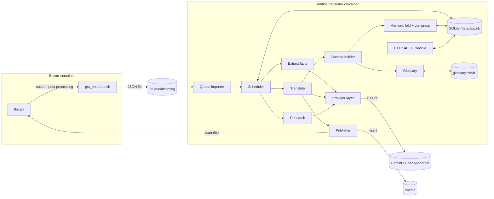
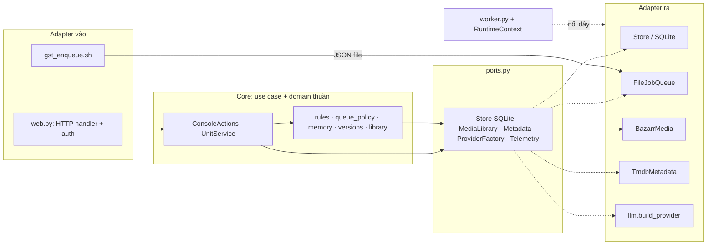
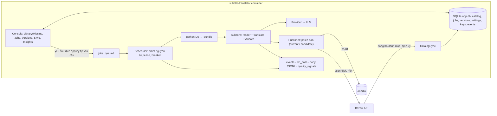
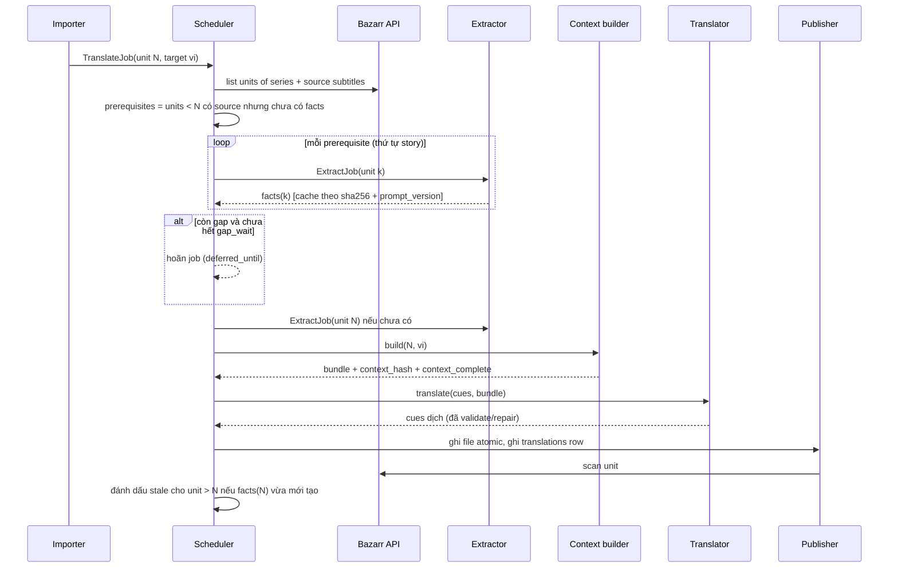

# ARCHITECTURE — LLM Subtitle Translator for Bazarr

> Trạng thái: **Draft v0.11** · 2026-11-15 (v0.11: đánh số lại phase P5–P16 theo thứ tự làm — §3.5 research làm cuối, §3.6 đề xuất và Review inbox, §4 `suggestions` thêm `source`; v0.10: thiết kế lại luồng job — ADR-10 đến ADR-16, §2 sơ đồ đích, §4 schema đích, §5, §6, §8; ADR-8 được điều chỉnh bởi ADR-12, ADR-9 bị thay bởi ADR-10/11, ADR-5 điều chỉnh, quy tắc upstream của ADR-2 bỏ; v0.4: lộ trình §7 chuyển sang [PLAN.md](../../PLAN.md); v0.5: xác thực bằng form đăng nhập + Basic Auth, đổi mật khẩu trong Settings — ADR-7, §4, §5, §6, §8; v0.9: ADR-8 ranh giới và port chuyển từ SPEC mục 9 sang §1 và §2, theo số phiên bản của SPEC; thêm ADR-9 chế độ `hold` ở §1, P0d phần 2) · Hiện thực hoá [SPEC.md](SPEC.md)
> Tài liệu này mô tả kiến trúc **đích**. Kiến trúc hiện tại kế thừa từ upstream nằm ở [docs/ARCHITECTURE.md](../ARCHITECTURE.md).

---

## 1. Các quyết định chính (ADR rút gọn)

### ADR-1 · Không giữ kiến trúc CLI của `gemini-srt-translator` (gst)

**Quyết định:** Viết engine dịch riêng dưới dạng **thư viện Python**, worker gọi trực tiếp trong process. Không gọi `gst` qua subprocess, không fork gst.

**Lý do (từ code upstream):**
- gst là CLI tương tác: khi token vượt giới hạn nó dừng lại hỏi người dùng nhập batch size mới (`main.py:752-758`), tự cài signal handler, và `main.py` có 39 chỗ gọi `input`/`exit()` nằm ngay trong logic dịch → không dùng làm thư viện được nếu không sửa sâu.
- Worker hiện tại phải **đoán lỗi bằng cách tìm chuỗi trong stdout** (`"429"`, `"consecutive errors"`, `"expected … lines … got"`) — dễ vỡ mỗi khi upstream đổi câu log.
- Những thứ spec cần đều nằm *trong* lời gọi LLM của gst: mục glossary riêng (FR-4.3), context bundle nhiều lớp (FR-5.2), sửa cue lỗi có chọn lọc (FR-3.3), provider khác Gemini (FR-9). Fork gst để làm những thứ này = viết lại gần hết `main.py` (1.767 dòng).
- Phần thực sự có giá trị của gst nhỏ và tách được: bộ quy tắc trong system prompt, JSON schema `{i, text}`, `json-repair`, ý tưởng giảm batch thích ứng. gst là **MIT** ⇒ chép phần này vào engine kèm NOTICE.

**Hệ quả:** mất "miễn phí" các cải tiến tương lai của gst. Chấp nhận: phần mượn chỉ ~300 dòng, theo dõi thủ công changelog upstream theo tháng.

### ADR-2 · Một repo, fork từ `gemini-srt-translator-bazarr`, cấu trúc uv workspace

**Quyết định:** GitHub fork `kingzleshe/gemini-srt-translator-bazarr` → repo của bạn. Remote `upstream` trỏ về repo gốc. **Không** đưa gst vào repo (ADR-1 đã bỏ phụ thuộc runtime).

```
llm-subtitle-translator/            # fork
├─ packages/
│  └─ subcore/                      # engine thuần: không biết Bazarr, không biết HTTP
│     ├─ srt.py                     # parse/serialize, validate thẻ
│     ├─ providers/                 # base.py, gemini.py, openai_compat.py, fake.py
│     ├─ translate/                 # planner (split), prompt builder, repair loop
│     ├─ memory/                    # extract, fold, compress, context_hash
│     ├─ glossary/                  # YAML load/merge/validate, pending suggestions
│     └─ cli.py                     # `subcore translate file.srt --glossary g.yaml` (dịch tay, debug)
├─ apps/
│  └─ worker/                       # code hiện có của fork, refactor dần (package `llm-subtitle-worker`)
│     ├─ gst_worker/bazarr.py, tmdb.py  # giữ từ upstream
│     ├─ scheduler.py               # MỚI: story-order scheduling, prerequisite, gap
│     ├─ store.py                   # MỚI: SQLite
│     ├─ http/ + static/            # console hiện có + trang glossary/state
│     └─ worker.py
├─ bazarr-postprocess/gst_enqueue.sh  # giữ nguyên giao thức thả file
├─ docs/  (tài liệu upstream) + docs/design/ (SPEC.md, ARCHITECTURE.md đích)
└─ Dockerfile, docker-compose.yml
```

**Đã làm ở P0:** root `pyproject.toml` là *virtual workspace root* (không có `[project]`), một `uv.lock` chung. `subcore` dùng `src/` layout (`packages/subcore/src/subcore/`), build bằng `uv_build`, cài editable. `apps/worker` khai báo `package = false` (chạy dạng script, giữ nguyên import `gst_worker`). Image chỉ cài member `llm-subtitle-worker` và giữ layout runtime cũ (`/app/worker.py`, `/app/gst_worker`, `/app/static`).

**Đã làm ở P1 (các chỗ tài liệu còn để mở):**
- `i` gửi cho LLM là **số thứ tự 1-based** của cue trong danh sách đã parse, không phải index trong file SRT (index có thể trùng/đứt quãng); `Cue` giữ nguyên `index` và dòng `timing` gốc, nên file ra trùng timecode byte-by-byte do cấu tạo.
- Cue rỗng/chỉ có khoảng trắng không gửi cho LLM, giữ nguyên.
- Vi phạm term `locked` được kiểm bằng so khớp chuỗi (không phân biệt hoa thường) và đưa vào vòng repair; nếu model vẫn từ chối sau 2 vòng thì giữ bản dịch và ghi cảnh báo, **không** fail job (lỗi cấu trúc — thiếu cue, hỏng thẻ — mới fail).
- `address_rules` dùng `a_to_b`/`b_to_a` dạng "xưng–hô" theo góc nhìn người nói; `from` bao gồm, `until` loại trừ; mốc thời gian trong tập được đổi sang số thứ tự cue trước khi vào prompt.
- Cắt part dùng ước lượng token offline (không gọi count_tokens để khỏi tốn quota); `MAX_TOKENS` trả về phần đã có để repair/split phần thiếu.
- Chia nhỏ sau khi repair hỏng: một cấp, số part = max(2, 2× số part đang dùng), có thể nhỏ hơn 100 cue.
- Lỗi provider (`RateLimited`…) chỉ được ném ra khỏi `translate()`; backoff/limiter là việc của P2.
- **Phát hiện lệch cue** (`translate/alignment.py`): model yếu có thể trả đủ mọi `i` nhưng gán sai văn bản (lệch 2–4 cue kéo dài hàng trăm cue; thấy ở `gemini-3.1-flash-lite`). Hai tín hiệu không phụ thuộc ngôn ngữ: (1) *anchor* — nhóm chữ số và tên riêng viết hoa giữa câu của source phải có trong bản dịch, và nếu chỉ thấy ở cue lân cận thì cue bị coi là lệch; (2) tương quan độ dài source–bản dịch trong cửa sổ trượt 20 cue, nếu dịch đi k cue cho tương quan tốt hơn hẳn thì cửa sổ lệch. Vùng lệch được gửi lại qua đúng vòng repair thông thường; nếu vẫn còn lệch thì chỉ cảnh báo, **không** fail job (heuristic). Giới hạn đã biết: đoạn lệch ngắn (~10 cue cuối file) không có anchor và không đủ cửa sổ thì không bắt được.

**Vì sao một repo thay vì "monorepo chứa 2 repo clone + set upstream":**
- Sau ADR-1 chỉ còn **một** upstream có ý nghĩa (worker Bazarr). gst chỉ là nguồn tham khảo.
- Giữ 2 repo upstream trong monorepo (git subtree/submodule) chỉ đáng khi định **merge upstream thường xuyên**. Ở đây fork sẽ phân kỳ mạnh (thay toàn bộ lớp dịch, thêm SQLite) nên merge tự động gần như không khả thi; thực tế sẽ là **cherry-pick** các fix tích hợp Bazarr. Remote `upstream` là đủ cho việc đó.
- Tách `subcore` thành package riêng trong workspace để: test không cần Bazarr, có CLI dịch tay, và sau này có thể publish riêng nếu muốn.

**Quy tắc làm việc với upstream:** branch `upstream-sync` theo dõi `upstream/main`; mỗi tháng xem diff các file `bazarr.py`, `gst_enqueue.sh`, `queue*.py`, cherry-pick fix liên quan.

**Bỏ từ v0.10 (SPEC quyết định #22):** fork đã thay hàng đợi, script và store (ADR-10, ADR-11), nên cherry-pick định kỳ không còn ý nghĩa; không còn đồng bộ upstream, skill `upstream-sync` không dùng nữa. Remote `upstream` giữ để đọc tham khảo.

### ADR-3 · Gemini-first, không Gemini-only

**Hiện trạng:** cả hai repo gốc gắn chặt Gemini — gst dùng `google-genai`, thinking config, service tier; worker phân loại lỗi theo chuỗi lỗi Gemini, dropdown model lấy từ Gemini.

**Quyết định:** interface `Provider` mỏng, tự viết (không dùng LiteLLM/LangChain):

```python
class Provider(Protocol):
    caps: Capabilities   # max_input, max_output, structured_output, web_search, limits
    def generate(self, req: LLMRequest) -> LLMResponse: ...      # raise RateLimited / QuotaExhausted / Unavailable / BadOutput
    def count_tokens(self, req: LLMRequest) -> int: ...
```

- Adapter v1: `gemini` (google-genai), `openai_compat` (OpenRouter, Ollama, LM Studio, vLLM…), `fake` (test).
- Lỗi được **chuẩn hoá thành exception có kiểu** trong adapter ⇒ scheduler không bao giờ đọc chuỗi lỗi.
- Tính năng phụ thuộc năng lực tự suy giảm: không `web_search` → bỏ research; context nhỏ → planner chia phần; không `structured_output` → JSON mode + json-repair + validate chặt hơn.
- Không dùng LiteLLM vì: chỉ cần 2–3 adapter; các tính năng cần (structured output + grounding + thinking) là chỗ LiteLLM hay "rò" khác biệt giữa provider; thêm một lớp khó debug.

**Phần vẫn gắn Gemini có chủ đích:** giá trị mặc định (model, quota free tier), research dùng Google Search grounding.

**Đã làm ở P7:**
- `subcore.providers.openai_compat` chỉ dùng thư viện chuẩn (`urllib`): stream SSE (đọc được cả server bỏ qua `stream` và trả một JSON), `stream_options.include_usage`, không bao giờ theo redirect (header `Authorization` đi theo redirect), khoá chỉ nằm trong header, không vào `repr` hay thông báo lỗi. 401/403 → `AuthError`, 404 → `ModelNotFound`, 402 và 429 mang mã `insufficient_quota` (đọc từ `error.code`/`error.type`, không đọc câu chữ) → `QuotaExhausted`, 429 còn lại → `RateLimited` (kèm `Retry-After`), 408/5xx/timeout/ngắt kết nối → `Unavailable`, rỗng hoặc không phải JSON → `BadOutput`.
- **Năng lực suy giảm có trạng thái:** adapter bắt đầu với `response_format: json_schema` (mảng gốc được bọc vào `{"items": [...]}` vì `json_schema` đòi object ở gốc; `parse_reply` đã tìm được danh sách trong object). Server trả 400/422 khi có `response_format` thì hạ xuống `json_object` (kèm câu dặn đặt danh sách vào khoá `items`), rồi xuống không format (chỉ prompt). Mỗi bậc hạ là một lần gọi hỏng; mức đã học được nhớ theo (base URL, model) trong process nên chỉ lần gọi đầu trả giá. Khi rời bậc `schema`, `caps.structured_output` thành `False` nên engine thôi gửi schema; mọi trả lời vẫn qua validate từng cue, nên server yếu hơn tốn thêm lượt repair chứ không cho phụ đề sai. Để adapter biết khi nào dùng JSON mode, `LLMRequest` có thêm `json_output` (engine dịch và trích facts đặt `True`; tóm tắt văn bản thì không).
- **Chọn provider là cài đặt toàn cục**, không theo khoá: `llm_provider` (`gemini` \| `openai_compat`) và `llm_base_url`; mọi tác vụ và cả hai tầng model chạy trên cùng một provider (trộn Gemini và server riêng trong một job để dành khi thật cần). `LiveProviderFactory` đọc provider và khoá còn dùng được (`api_keys.provider`) ở mỗi lần dựng nên đổi nóng. Server riêng không cần khoá: không có khoá nào thì dựng một provider không có header `Authorization`. `build_provider` thêm giới hạn `llm_max_input_tokens`/`llm_max_output_tokens` vì server không nói được model cho phép bao nhiêu; `LLM_RPM` mặc định không giới hạn với `openai_compat`.
- **Model theo tác vụ (FR-9.3):** `config.model_for_task` (thuần) là nơi duy nhất ánh xạ tác vụ → model: `translate` = `gst_model`; `extract` = `memory_model`; `summarize` = `summarize_model` → `memory_model`; `research` = `research_model`; mỗi cái rơi về `gst_model` khi trống. `research` chưa có ai gọi (P16).
- Chưa làm: hạ `QuotaExhausted` của `openai_compat` thành trạng thái khoá `exhausted` và breaker (P8; hiện hết tiền hay hết quota đều tạm dừng model 24 giờ như quota ngày của Gemini); thử tay với Ollama hoặc OpenRouter thật; chọn provider theo từng model; giao diện chọn provider (chờ đợt thiết kế giao diện, hiện đặt qua `POST /api/settings`).

### ADR-4 · Một container, một process

**Quyết định:** Một image, một container `subtitle-translator`, một process Python: thread worker + HTTP server (như hiện tại). State trong volume `/data` (SQLite + glossary YAML + backup). Script enqueue vẫn chạy trong container Bazarr.

**Lý do:**
- Quota LLM là nút thắt, không phải CPU ⇒ thêm worker song song không tăng tốc mà chỉ tăng 429.
- SQLite chỉ có một writer ⇒ đơn giản, không cần DB server.
- Homelab: ít thứ để update/backup.

**Khi nào tách:** (a) dùng LLM local → thêm container `ollama` riêng (provider `openai_compat` trỏ tới); (b) nhiều người dùng/nhiều instance Bazarr → tách worker và console, đổi SQLite sang Postgres. Cả hai không thuộc v1.

### ADR-5 · Lưu trữ: SQLite cho máy, YAML cho người

| Dữ liệu | Nơi lưu | Lý do |
|---|---|---|
| Glossary (người viết/duyệt) | `/data/series/<series_key>/glossary.<lang>.yaml` | Sửa tay bằng editor, diff được, backup bằng copy. |
| Đề xuất `pending` | SQLite `suggestions` | Máy sinh, cần trạng thái duyệt. |
| Facts, story state cache, translations, jobs | SQLite `/data/app.db` | Cần truy vấn ("facts của mọi unit < N", "bản dịch stale"). |
| Tài khoản console (mật khẩu băm, bí mật phiên) | SQLite `app.db`, bảng `auth` | Máy sinh và đổi được qua console; không để trong `config.json` (file đó được backup và hiện qua `/api/settings`). |
| Queue đầu vào | `/queue/incoming/*.json` (giữ giao thức cũ) | Script trong Bazarr không đổi. Worker import file → bảng `jobs` rồi xoá file. |

**[Đổi so với SRS]** SRS đề xuất JSON/TXT trước, SQLite sau. Bỏ giai đoạn file: truy vấn staleness/prerequisite trên file JSON sẽ phải viết lại khi lên SQLite.

**Điều chỉnh (v0.10).** Hai hàng của bảng trên đổi ở các phase sau: (1) **queue đầu vào** không còn là file, nó là bảng `jobs`; script Bazarr bị bỏ nên không còn thư mục `incoming` (ADR-10, ADR-11, P8–P10). (2) **glossary** chuyển từ YAML vào SQLite, YAML chỉ nhập/xuất (ADR-14, P12). Nguyên tắc "SQLite cho máy, YAML cho người" thành "SQLite cho cả hai; YAML chỉ cho cấu hình hệ thống lúc khởi động và làm định dạng trao đổi". Đến hết phase trước đó bảng trên vẫn mô tả đúng code.

### ADR-6 · Memory: facts theo tập + fold xác định, không dùng memory framework

**Quyết định:** event-sourcing đơn giản. Mỗi unit có **facts bất biến** (trích từ source subtitle); story state @N là **phép fold xác định** trên facts các unit < N. Chỉ phần *nén tóm tắt cũ* mới dùng LLM, và được cache.

**Vì sao giải quyết được ví dụ "tập 1 người yêu, tập 6 kẻ thù, dịch tập 6 trước":**

| | Snapshot tích luỹ (đề xuất trước) | Facts theo tập + fold (thiết kế này) |
|---|---|---|
| Tập 1 dịch sau tập 6 có bị nhiễm "kẻ thù"? | Không (chỉ lấy snapshot < 1) | Không (fold rỗng) |
| Tập 6 dịch đầu tiên có biết quan hệ ở tập 1–5? | **Không** — snapshot trước 6 chưa tồn tại | **Có** — prerequisite trích facts 1–5 từ source trước |
| Tập 7 sau khi tập 1–5 được dịch muộn? | Snapshot tập 6 thiếu 1–5 → **sai dây chuyền** | Fold lại từ facts, luôn đúng |
| Nguồn của memory | Bản dịch (phụ thuộc thứ tự dịch) | Source subtitle (không phụ thuộc thứ tự) |

Lỗ hổng thật của đề xuất trước là chiều ngược lại và lỗi dây chuyền; thiết kế này loại bỏ cả hai vì facts không phụ thuộc thứ tự dịch.

**Correction trong mô hình này:** glossary (gồm correction scope `forward`/`series`) là lớp **ghi đè** đặt trên fold, không sửa facts. Facts vẫn là "máy thấy gì trong phụ đề gốc"; người chỉ sửa cách dịch. Nhờ vậy correction không bao giờ bị lần trích xuất lại xoá mất.

**Vì sao không Mem0/Zep/LangGraph/LlamaIndex** (đã phân tích ở vòng trước): memory nhỏ (≤ 8k token) nên không cần retrieval; cần phiên bản theo *story order* chứ không theo thời gian thực; quota thấp không chịu được ingestion nhiều lời gọi; glossary phải sửa tay. Mem0 ghi đè (mất lịch sử), Zep cloud vi phạm NFR-6, Graphiti nặng; LangGraph/LlamaIndex trùng với scheduler.

### ADR-7 · Duyệt / correction / dịch lại nằm trong console của worker

**Quyết định:** Mở rộng console tĩnh sẵn có (`static/`, vanilla JS không build step, cùng process, cùng port 6789). Không làm UI riêng.

| Phương án | Đánh giá |
|---|---|
| **Console worker (chọn)** | Cùng process, đọc thẳng SQLite + YAML; đã có khung điều hướng, settings, logs; không thêm container/port. |
| UI của Bazarr | Bazarr không có cơ chế plugin/extension cho UI ⇒ không chèn được nút. Chỉ dùng Bazarr cho việc nó đã làm: hook + scan. |
| Plugin Jellyfin/Plex ("báo câu sai" ngay trong player) | Trải nghiệm tốt nhất nhưng mỗi player một plugin, ngôn ngữ khác (C#/…), gắn với player bạn đang dùng. Ngoài v1; API ở mục 5 đủ để làm sau. |
| SPA riêng (React…) | Thêm build pipeline + container, trùng chức năng console. |
| Chỉ sửa file YAML bằng tay | Vẫn được hỗ trợ (YAML là nguồn sự thật), nhưng không đủ cho duyệt có bằng chứng, tìm cue theo timecode, diff/hoàn tác. |

**Trang mới:**
- **Review** — hộp duyệt `pending` (FR-11.1), badge trên nav.
- **Library** — series → tập; mỗi tập: trạng thái bản dịch (`current`/`stale`/`incomplete`), lọc theo trạng thái.
- **Episode** — bảng song song gốc–dịch, ô "nhảy tới timecode", tìm text; chọn cue → thêm correction / sửa trực tiếp; nút **Dịch lại** (form FR-11.3.2); tab **Lịch sử** (các phiên bản, diff, hoàn tác); tab **Context** (story state @N đã dùng để dịch — để hiểu vì sao model xưng hô như vậy).
- **Glossary** — sửa theo series; lưu xuống YAML; hiện số bản dịch sẽ stale.

Yêu cầu UI: responsive (điện thoại), không phụ thuộc CDN (homelab có thể offline).

**Xác thực** (SPEC NFR-5, quyết định #8): một middleware trong HTTP handler chặn **mọi** request trước khi route (static + `/api/*`). Ngoại lệ duy nhất, hẹp: trang đăng nhập (`GET /login`, tài nguyên tĩnh của riêng nó) và `POST /api/auth/login`. Một tài khoản, hai cách vào:

| Cách vào | Dùng cho | Cơ chế |
|---|---|---|
| Form đăng nhập | Trình duyệt | `POST /api/auth/login` → cookie phiên `gst_session` (`HttpOnly`, `SameSite=Strict`, thêm `Secure` khi `X-Forwarded-Proto: https`), token ký HMAC bằng bí mật phiên trong `app.db`, hết hạn sau 7 ngày không dùng (token được cấp lại khi đã quá 1 giờ tuổi, nên không cần trạng thái từng phiên), đổi mật khẩu thì bí mật xoay và mọi phiên cũ mất hiệu lực. Đăng xuất đưa id token vào danh sách chặn trong bộ nhớ (mất khi restart). Request ghi (POST/PUT) bằng cookie bị kiểm `Origin`/`Host` khớp. Chưa đăng nhập: `GET` trang HTML → chuyển tới `/login`; `/api/*` → `401` JSON **không** kèm `WWW-Authenticate` (để trình duyệt không bật hộp Basic Auth). |
| Basic Auth | Script, Home Assistant (FR-10.3) | Header `Authorization`, cùng tài khoản; `401` kèm `WWW-Authenticate` chỉ khi request không mang cookie và không xin HTML. |

Tài khoản nằm trong `app.db` (bảng `auth`, một dòng): tên đăng nhập, mật khẩu băm `scrypt` kèm salt, bí mật phiên. Khởi động: nếu chưa có dòng nào mà có `CONSOLE_USER` + `CONSOLE_PASSWORD` thì tạo từ env; nếu đã có thì **bỏ qua env**, trừ khi `CONSOLE_PASSWORD_RESET=1` (ghi đè bằng env, xoay bí mật phiên, log cảnh báo bỏ cờ). Chưa có dòng nào và thiếu env ⇒ `503` như P0b; không có trang "đặt mật khẩu lần đầu" vì nó mở cho cả LAN trước khi ai đó kịp đặt. `CONSOLE_AUTH=off` vẫn là cách tắt duy nhất (log cảnh báo mỗi lần khởi động). Đổi mật khẩu: `POST /api/auth/password` cần mật khẩu hiện tại, mật khẩu mới ≥ 8 ký tự. Đăng nhập sai 5 lần liên tiếp từ một địa chỉ ⇒ khoá 5 phút (đếm chung cho form và Basic Auth, trong bộ nhớ). So sánh bằng `hmac.compare_digest`; mật khẩu, cookie và `Authorization` không bao giờ vào log, `config.json`, `/api/settings` hay `RuntimeContext` dưới dạng serialize được. Tên đăng nhập không đổi được qua console (đổi bằng reset). Backup (`backups.py`) hiện chỉ gồm `config.json` và `targets.json`, nên không mang theo mật khẩu băm; nếu sau này backup mở rộng sang `app.db` thì phải loại bảng `auth`, và restore không bao giờ ghi đè nó.

### ADR-8 · Core của worker không biết hạ tầng; DB nằm sau port

**Quyết định:** kiến trúc cổng–adapter có chọn lọc cho `apps/worker`; `subcore` giữ nguyên (đã đúng hướng: `Provider` là port, core thuần, không biết Bazarr/queue/HTTP). Lý do: `Store` từng là một class hơn 30 method trộn sáu mối quan tâm (tài khoản, log lời gọi LLM, phiên bản bản dịch, catalog, facts/summary của memory, cache), trả `dict[str, Any]` nên người gọi biết tên cột; use case `units.py` import thẳng `queue.enqueue_retranslation` và `llm.build_provider`. Đã làm xong ở P0d phần 1, hành vi không đổi.

1. **Ba lớp.** Adapter vào (HTTP handler `web.py`, `gst_enqueue.sh`, CLI) → **use case** + domain thuần (`ConsoleActions`, `UnitService`, `rules`, `queue_policy`, story memory, quy tắc phiên bản) → **port** (`Protocol` trong `gst_worker/ports.py`) ← adapter ra (SQLite, hàng đợi file, Bazarr, TMDB, `subcore.providers`).
2. **Port hẹp theo nơi dùng, không có một `Store` Protocol chung.** Mỗi nơi chỉ thấy phần nó cần, nên test dựng fake nhỏ. `Store` (SQLite) vẫn là một class cài năm port lưu trữ, vì chúng dùng chung một kết nối và một chuỗi migration; không ai ngoài `worker.py` biết nó là `Store`.
3. **Chỉ tạo port ở ranh giới thật:** lưu trữ bền, hàng đợi, dịch vụ ngoài, provider. Filesystem (`pathlib`, ghi atomic) không bọc port; test dùng thư mục tạm.
4. **Port trả kiểu có tên** (dataclass bất biến: `Account`, `LlmCall`, `TokenTotals`, `TranslationVersion`, `StoredFacts`, `Series`, `Unit`, `Output`, `Correction`, `MediaDetails`, `EpisodeListing`), không trả `dict`/`sqlite3.Row`. Tên cột chỉ tồn tại trong adapter SQLite. Test 10c quét kiểu trả về trong `ports.py`.
5. **Port nằm ở core, adapter nằm riêng; core không import adapter.** Việc nối dây ở `worker.py` và `RuntimeContext` (composition root). Adapter là các module liệt kê trong `tests/test_core_boundary.py` (`store`, `queue`, `http`, `bazarr`, `tmdb`, `gemini`, `llm`, `backups`, `connection_tests`, `settings`, `web`); module nào không có trong danh sách là core và bị kiểm mặc định. `worker.py` được phép import adapter nhưng không được import `sqlite3`, socket hay `http.server` trực tiếp.
6. **Hai đường vào, một tầng use case.** HTTP và CLI gọi cùng use case; handler chỉ parse, xác thực, gọi use case, định dạng phản hồi (việc dựng job của `/api/enqueue` nằm ở `ConsoleActions`, không ở handler). CLI `subcore` giữ nguyên (adapter vào của engine). Nếu thêm CLI cho worker: khi worker đang chạy, thao tác **ghi** đi qua HTTP API, không mở SQLite trực tiếp (ADR-4: một writer); lệnh chỉ đọc có thể đọc trực tiếp. Các route quản trị không thuộc miền (cài đặt, trạng thái, backup, log, test kết nối) vẫn gọi thẳng module từ handler.
7. **Hàng đợi vẫn là cây thư mục JSON** (giao thức `gst_enqueue.sh` không đổi), chỉ được bọc bằng port `JobQueue` ở phía gửi và quản lý job. Phía tiêu thụ (claim, hoãn, quota, recover) là lớp `queue.JobQueue` của adapter, cùng tên nhưng khác module, và `process_job` vẫn ở `worker.py` vì dùng `skip_reason` của adapter. Bảng `jobs` vẫn hoãn (PLAN P2); khi làm thì chỉ thêm adapter, không sửa core.

| Port | Phụ trách | Adapter |
|---|---|---|
| `AuthRepo` | tài khoản duy nhất, bí mật phiên | `Store` (`auth`) |
| `UsageLog` | lời gọi LLM, tổng token (NFR-7) | `Store` (`llm_calls`) |
| `VersionRepo` | phiên bản bản dịch, cache theo `context_hash` (NFR-3) | `Store` (`translations`) |
| `CatalogRepo` | series, unit, output, correction, cấu hình memory theo series | `Store` |
| `MemoryRepo` | facts, summary nén, snapshot context | `Store` |
| `JobQueue` | enqueue, enqueue dịch lại, retry, cancel, delete; job `held`/`rejected` (ADR-9) | `queue.FileJobQueue` (cây thư mục JSON) |
| `MediaLibrary` | mô tả tập, liệt kê tập và source subtitle, `missing_subtitles`, yêu cầu scan lại | `bazarr.BazarrMedia` (đọc settings sống) |
| `Metadata` | mô tả phim/series cho prompt | `tmdb.TmdbMetadata` (đọc settings sống) |
| `ProviderFactory` | dựng provider theo model và key | `llm.build_provider` (`subcore.providers`) |

**Kiểm bằng test, không bằng quy ước (tiêu chí 10):** `tests/test_core_boundary.py` (10a: core không import hạ tầng, danh sách ngoại lệ đã rỗng và chỉ được thu hẹp; 10c: port không trả `dict`/`Any`/`Row`) và một bộ test hợp đồng cho mỗi port chạy trên adapter thật và trên fake trong bộ nhớ (10b: `tests/test_*_contract.py`). **Từ P8 (ADR-12):** 10b chỉ còn cho port biên ngoài (`MediaLibrary`, `Metadata`, `ProviderFactory`); các kho SQLite có test hợp đồng trên `Store` thật, không có fake; 10c cũng kiểm các phương thức công khai của `Store`.

**Đánh đổi chấp nhận:** nhiều file hơn và thêm một lớp gián tiếp; với một người dùng và một SQLite, phần lớn port chỉ có một adapter thật, lợi ích chính là test không cần hạ tầng và cửa để đổi storage sau này. `Store` chưa tách thành một file mỗi port: không có người gọi nào còn phụ thuộc vào nó, nên việc tách chỉ là dọn dẹp và được hoãn cho tới khi có lý do (một adapter thứ hai).

**Không làm (trong ADR-8):** chuyển hàng đợi vào SQLite; đổi schema; bọc filesystem bằng port; thêm DB khác (Postgres chỉ là cửa để ngỏ, theo ADR-4); đổi `subcore`.

**Điều chỉnh (v0.10, ADR-12).** Điểm 2, 3, 4, 7 và bảng port bên trên mô tả code hiện tại. Từ P8, port chỉ giữ ở biên mà ta không sở hữu (`MediaLibrary`, `Metadata`, `ProviderFactory`); `AuthRepo`, `UsageLog`, `VersionRepo`, `MemoryRepo`, `CatalogRepo`, `JobQueue` thành repository SQLite cụ thể. Điểm 6 (CLI cho worker) bỏ: không có adapter vào thứ hai (ADR-16). Điểm 7 (hàng đợi là cây thư mục) hết hiệu lực khi `jobs` vào SQLite (ADR-11). **Đã làm ở P8:** các Protocol `AuthRepo`, `UsageLog`, `VersionRepo`, `MemoryRepo`, `CatalogRepo`, `SettingsRepo`, `TelemetryRepo` bị gỡ khỏi `ports.py` (các kiểu bản ghi có tên vẫn ở đó); core nhận `Store` trực tiếp, không tách module `db/` riêng; các fake trong bộ nhớ và test `isinstance(…, Port)` bị gỡ cùng lúc. `JobStore` (`jobs.py`) vẫn trả `dict` cho payload của job: đây là điểm lệch còn lại so với 10c.

### ADR-9 · Chế độ `hold`: worker quyết định lúc nhận job (FR-12)

> **Bị thay thế (v0.10)** bởi ADR-10 (Bazarr chỉ là nguồn danh mục; không có gì tự vào hàng đợi) và ADR-11 (job trong SQLite). Mô tả dưới đây đúng cho code hiện tại cho đến P10, khi `held/`, `rejected/`, `admission_mode` và tab Held được gỡ.

**Quyết định:** script Bazarr không đổi (nó không đọc được cài đặt của worker, FR-12.3) và vẫn ghi thẳng vào `pending/`; **worker** áp chế độ ngay trước mỗi lần claim (`QueueWorker.process_once` → `queue.JobQueue.admit_new_jobs`). Đã làm xong ở P0d phần 2.

1. **Hai trạng thái thư mục mới:** `held/` (đã nhận, chưa chạy) và `rejected/` (dấu từ chối, giữ nguyên file job để khôi phục được). Cả hai không bao giờ được claim, không bị `_fail_waiting_quota_jobs` đụng vào, không bị `recover_interrupted_jobs` thả (FR-12.8), và không tính vào `GST_MAX_PENDING` (script chỉ đếm `pending/processing/deferred`). Từ chối nhớ theo **job id** (sha1 của đường dẫn nguồn, đường dẫn đích, ngôn ngữ), nên script hay scan gặp lại cùng mục đều dính dấu này.
2. **Phân biệt job của script với job đã được nhận bằng trường `admission` trong file job.** Job do script ghi không có trường này. Worker ghi `admin` khi tạo job (Enqueue, Scan, dịch lại, retry), `auto` khi bắt đầu chạy một job hoặc khi bật `hold` lên cho các job đang chờ, `approved` khi duyệt. Ở `hold`, job `pending` chưa có `admission` (và không nằm ngoài `GST_ONLY_PATHS`) chuyển sang `held` kèm `held_at`. Định dạng file job mà script ghi không đổi; chỉ phía worker thêm một trường. Ở `auto` worker không sửa file nào, vì thế hành vi cũ không đổi (tiêu chí 11a).
3. **Đổi chế độ không đụng job đang có (FR-12.8):** `QueueWorker.apply_settings` thấy `auto → hold` thì gắn `admission: auto` cho job `pending`/`deferred` đang có (giữ nguyên thời gian file để không đổi thứ tự) *trước khi* áp chế độ mới; `hold → auto` không thả gì. Chạy một job cũng gắn `admission: auto`, nên job bị ngắt rồi khôi phục không bị giữ.
4. **Script ghi lại job đang `held` hoặc `rejected`:** bản `pending` trùng id bị xoá (ở cả hai chế độ; một lần kiểm tra thư mục mỗi tick). Admin enqueue/scan bỏ qua id đang `held` hoặc `rejected` (nên `Enqueue` đúng một mục đang held trả `count: 0`; khôi phục hoặc duyệt nó thay vì tạo lại).
5. **Duyệt** chuyển `held → pending` (`admission: approved`) và từ đó đi qua đúng đường cũ: `skip_reason` và `target_still_missing` chặn khi đích đã có (FR-12.6), `GST_ONLY_PATHS` vẫn chặn, `GST_MAX_PENDING` không áp (FR-12.7). Duyệt bị từ chối khi đang nghỉ quota ngày (giống enqueue). Use case `ConsoleActions.approve/reject/restore` chọn job theo đúng một cách (`job_ids`, `series_id` hoặc `all`); port `JobQueue` chỉ có `held`, `rejected`, `approve`, `reject`, `restore` theo danh sách id, kiểu trả về `HeldJob`. Job id đi vào tên file nên bị chặn nếu không phải tên file thuần.
6. **Console:** `GET /api/queue/held` không giới hạn (snapshot `/api/queue` vẫn chỉ trả 100 job mỗi trạng thái); tab Held nhóm theo series (`series_id`, hoặc thư mục cho phim) và xin xác nhận khi duyệt/từ chối nhiều job.

**Đánh đổi:** không có bảng `jobs` nên "trạng thái" vẫn là thư mục; số cue của một job `held` đọc từ file phụ đề (cache theo mtime). Chọn `auto`/`hold` theo từng series để v1.1 (SPEC).

### ADR-10 · Bazarr là nguồn danh mục; worker kéo, không nhận đẩy (FR-14)

**Quyết định:** worker đồng bộ danh mục series, phim, tập và `missing_subtitles` từ Bazarr API vào bảng `catalog_items` (cache có dấu thời gian). Trang Library duyệt cache đó như duyệt trong Bazarr. Bỏ `gst_enqueue.sh`, thư mục queue chung giữa hai container, và `GST_MAX_PENDING`. Làm ở P10.

**Lý do:**
- "Thiếu phụ đề" là **trạng thái hiện tại** của một đối tượng, không phải sự kiện. Đẩy sự kiện buộc phải xử lý `superseded`, trùng lặp, trạng thái lệch và việc đếm `pending` trước khi worker quét (đã gây lỗi thật: `GST_MAX_PENDING=5` cắt mất 5/10 tập ở lần thử đầu).
- Thấy được backlog có từ trước khi cài script, và tự chữa khi Bazarr đổi.
- Bỏ giao thức file, volume chung, và cấu hình `GST_*` lặp ở hai container; worker chỉ còn nói chuyện với Bazarr qua API (cộng việc ghi `.srt` cạnh media qua `/media`).

**Cơ chế:**
1. `MediaLibrary` (port biên ngoài) thêm `catalog()` phân trang; adapter `BazarrMedia` cài. `CatalogSync` chạy định kỳ (`catalog_sync_interval`) và theo nút **Đồng bộ ngay**; nó chỉ ghi `catalog_items`, không tạo job.
2. **Bảo vệ cache (FR-14.2):** chỉ áp một lần đồng bộ khi nhận đủ và hợp lý. Lỗi, hết thời gian, rỗng hoặc co lại hơn `catalog_shrink_guard` thì bỏ, giữ cache, hiện cảnh báo. Mục chỉ coi là biến mất khi một lần đồng bộ đầy đủ không thấy nó (cột `gone_at`).
3. **Định danh** bằng id Bazarr (+ `series_key`); đường dẫn là thuộc tính phân giải lúc chạy.
4. **Trạng thái dẫn xuất** (FR-14.5) tính trong read model của `Library` từ `catalog_items`, `versions`, `jobs`, `unit_decisions`; không có cột trạng thái tổng.
5. **Policy tự yêu cầu** (FR-15.4) chạy sau mỗi lần đồng bộ: tạo job `fill` `origin = policy` cho mục Missing trong phạm vi, bỏ Ignored và Removed.
6. **Chuyển tiếp:** script và `hold` vẫn chạy đến P10. P10 thêm importer một lần (`held` → Missing, `rejected` → `unit_decisions(ignored)`, `pending`/`deferred` → `jobs`, `done`/`failed` → lịch sử, đưa cây thư mục cũ sang `queue.migrated/`), rồi gỡ script, hướng dẫn gỡ post-processing khỏi Bazarr (`docs/BAZARR.md`) và volume postprocess khỏi compose.

**Đánh đổi:** mất tín hiệu "provider nào vừa tải xong" của post-processing. Chấp nhận: cửa `settle` đã dựa trên mtime của file nguồn, không cần tín hiệu đó; polling vài phút là đủ cho phụ đề. Thêm tải lên Bazarr khi thư viện lớn, giảm bằng đồng bộ tăng dần (mục 8, câu hỏi 2).

### ADR-11 · Job và phiên bản trong SQLite; một worker, claim nguyên tử (FR-15, FR-16, FR-17)

**Quyết định:** bảng `jobs` thay cây thư mục queue; bảng `versions` (mở rộng `translations`) thay cho việc suy phiên bản từ file; bảng `provider_health` giữ trạng thái breaker. Huỷ quyết định "bảng `jobs` hoãn" của ADR-8 và PLAN P2. Làm ở P8.

**Lý do:** những thứ cần ở đây file không làm được: ràng buộc một job mở mỗi (unit, ngôn ngữ, loại), chọn việc theo lớp ưu tiên và vòng tròn series, lease và heartbeat, metrics (FR-19.5), thống kê `model_layers` không bị cửa sổ file giới hạn (FR-13.7).

**Quyết định cụ thể:**
1. **Trạng thái job:** `queued` · `running` · `waiting` (cột `wait_reason`: `quota` \| `provider` \| `context` \| `settle` \| `rate`) · `done` · `failed` · `cancelled` · `skipped`. Từ P8 đến P10 có thêm `held` cho job do script tạo (ADR-9), bỏ ở P10. `failed` chỉ cho lỗi của job (FR-15.8).
2. **Chọn việc** là một câu lệnh nguyên tử trong `BEGIN IMMEDIATE`, sắp theo lớp ưu tiên, vòng tròn series (`series_rr`), `created_at`, có aging. Job cần tầng model đang tạm dừng bị lọc ra, không chặn hàng đợi. Không cắt ngang job đang chạy: một tập chỉ chạy vài phút, và thêm điểm dừng ở ranh giới batch chỉ làm khi có số liệu.
3. **"Một luồng" chỉ đúng với worker.** HTTP server là các thread khác cũng ghi, nên SQLite dùng WAL, `busy_timeout`, transaction ngắn; thao tác của người dùng (yêu cầu, huỷ, đổi ưu tiên) là các lệnh ghi riêng, không giữ khoá lâu.
4. **Lease:** `lease_until` gia hạn bởi heartbeat. Recovery chạy tường minh lúc khởi động và khi quét lease hết hạn (giữ invariant "tạo handle không recover"); `attempts + 1`; quá `max_crashes` thì `failed` lý do `crashed`.
5. **Publish an toàn khi sập (FR-16.5):** ghi file tạm → ghi `publishing` vào DB → rename → xác nhận `current`. Khởi động đối chiếu sha256 file đích với DB để hoàn tất hoặc huỷ. `refresh` Bazarr tách thành việc nền riêng, thử lại được, không ảnh hưởng kết quả job.
6. **Khoá lạc quan:** job ghi `base_version` (và `source_sha256`) lúc claim; lúc publish `current` khác hoặc nguồn đã đổi thì kết quả thành `candidate` (FR-16.3, FR-15.10).
7. **Breaker và chính sách chờ** nằm trong `queue_policy.py` (thuần, mở rộng): `provider_health(key_id, model, state, consecutive_failures, until, reason)`; ngưỡng, backoff và mốc reset là hàm thuần có test. Lỗi provider (`AuthError`, `QuotaExhausted`…) đi từ `TranslationAttempt` lên bằng kiểu, chuyển job về `waiting` kèm lý do (FR-17.1, ADR-3).
8. **Phiên bản:** `origin`, `status` (`current` \| `superseded` \| `removed` \| `pruned` \| `candidate`), `parent`; tối đa một `current` mỗi (unit, ngôn ngữ) (chỉ mục duy nhất có điều kiện). Các lần sửa cue liên tiếp gộp trong `edit_coalesce_minutes`. `removed` là tombstone nhớ ý định của admin (FR-16.6).
9. **Importer một lần** từ cây thư mục queue và `translations` hiện có, idempotent theo job id (sha1 cũ giữ làm khoá nhập), chạy lại không nhân đôi (tiêu chí 13i). Cây cũ đưa sang `queue.migrated/`, không xoá.
10. **Dọn file (FR-13.7):** nhóm file job thành dọn dòng `jobs`; P9 làm sau P8.

**Đánh đổi:** migration lớn (viết lại `queue.py` ~850 dòng và các test hàng đợi); đổi lại bỏ được ba nơi lưu trạng thái (file queue, SQLite, JSON cấu hình) thành một. Cổng nhận file từ `gst_enqueue.sh` (importer định kỳ) giữ đến P10 để không gãy hệ thống đang chạy.

**Đã làm ở P8 (chốt các điểm ADR để ngỏ):** (1) publish là *thông báo → đổi tên → xác nhận* (FR-16.5); khi khởi động, file khớp sha256 của bản đã thông báo thì xác nhận, không khớp thì huỷ: bản đó thành `candidate`, bản đang nằm trên đĩa được đưa lại thành `current` nếu khớp, còn không thì file được ghi nhận là `external` và là `current` (không mất nội dung nào). (2) Xoá phụ đề đích tạo một phiên bản `removed` chứa bản sao nội dung, để hoàn tác được; file bị xoá ngoài console được ghi nhận cùng cách lúc khởi động. (3) Sửa cue gộp trong `edit_coalesce_minutes` bằng cách ghi đè bản sao của chính phiên bản `edit` đó, không tạo phiên bản mới. (4) Job `replace` lấy `base_version` lúc bắt đầu chạy, không lúc vào hàng đợi. (5) Phụ đề đích xuất hiện trong lúc job tự động chạy, hoặc nguồn đổi, thì kết quả thành `candidate` (không ghi đè, không bỏ mất).

### ADR-12 · Port chỉ ở biên không sở hữu (điều chỉnh ADR-8)

**Quyết định:** giữ port cho thứ ta **không sở hữu**: Bazarr (`MediaLibrary`), TMDB (`Metadata`), provider LLM (`ProviderFactory`). SQLite là phần của ứng dụng: `AuthRepo`, `UsageLog`, `VersionRepo`, `MemoryRepo`, `CatalogRepo`, `JobQueue` trở thành các repository cụ thể trên SQLite (module `db/`, vẫn trả kiểu có tên), và test chạy trên SQLite `:memory:` thật với đúng chuỗi migration. Core được import `db`; vẫn cấm import HTTP client, SDK provider, adapter Bazarr/TMDB.

**Lý do:** ADR-8 tự nhận "phần lớn port chỉ có một adapter thật". `ports.py` (473 dòng) cộng fake và test hợp đồng cho các kho đó là nghi lễ: SQLite trong bộ nhớ rẻ hơn viết fake và kiểm đúng cái chạy thật (ràng buộc duy nhất, giao dịch, migration). Điều ADR-8 cần giữ (core không dính hạ tầng ngoài, kiểu trả về có tên) vẫn giữ.

**Áp dụng:** từ P8, gỡ dần khi chạm vào từng phần (`JobQueue` mất khi `queue.py` bị thay; các port khác gỡ khi sửa module liên quan), không có đợt refactor riêng. Cập nhật cùng lúc: NFR-10, tiêu chí 10 (10a chỉ quét import hạ tầng ngoài; 10b chỉ còn cho port biên ngoài; 10c giữ cho kiểu trả về của repository), `tests/test_core_boundary.py`, phần "Seams" của `AGENTS.md`.

**Không làm:** viết lại hàng loạt chỉ để bỏ port; đổi `subcore` (đã đúng hướng, ADR-2).

### ADR-13 · Cài đặt và khoá API trong DB (FR-20)

**Quyết định:** hai bảng: `settings(key, value_json, updated_at)` và `api_keys(id, provider, label, value, status, last_used_at)`. Thứ tự ưu tiên: **DB > env/yml > mặc định**. yml/env chỉ chứa cấu hình hệ thống lúc khởi động (đường dẫn, cổng, `DATA_DIR`, đường dẫn DB, tài khoản console khởi tạo); danh sách khoá hệ thống không ghi đè được từ UI cố định trong code. Làm ở P6.

**Cơ chế:**
1. **Hiệu lực ngay:** `RuntimeContext.apply_settings` (đã có) mở rộng; `ProviderFactory` lấy khoá từ nguồn sống mỗi lần dựng provider, nên đổi khoá không cần khởi động lại. `subcore` chỉ nhận khoá qua tham số.
2. **Gieo từ env lần đầu** (`GEMINI_API_KEY*`), sau đó DB thắng, cùng khuôn với tài khoản console (ADR-7). `config.json` được importer đưa vào `settings` một lần, không đè giá trị đã sửa.
3. **Luồng khoá hết hạn (FR-17.5):** `AuthError` → khoá `invalid`, provider tạm dừng, job `waiting · provider` → admin dán khoá mới và bấm Thử khoá → provider mở, job tự chạy tiếp.
4. **Bảo vệ:** giá trị khoá chỉ trả 4 ký tự cuối qua API; bộ lọc che bí mật dùng chung cho log, event, body prompt, báo cáo lỗi; file DB quyền `0600`; backup (`backups.py`) mặc định loại `api_keys` và bảng `auth` (mở rộng ghi chú ở ADR-7: restore không bao giờ ghi đè `auth`). Không mã hoá giá trị khoá: phải đọc lại được, và khoá chủ đặt cạnh DB không tăng bảo vệ đáng kể.
5. **Khoá nhiều:** schema hỗ trợ danh sách (FR-9.4) để thay thế hoặc dự phòng; trạng thái theo từng khoá; hạn mức Gemini tính theo project nên không dùng để vượt hạn mức (SPEC non-goals).

**Đã làm ở P6** (các chỗ tài liệu để mở): khoá của Bazarr và TMDB cũng nằm trong `api_keys` (`provider` = `bazarr`/`tmdb`) để một nơi giữ mọi bí mật và backup loại trừ chung; `settings` giữ thêm các dòng đánh dấu bắt đầu bằng `_` (`_config_json_imported`, `_keys_seeded`) cho importer một lần, không hiện ra và không sửa được từ console. Console vẫn sửa khoá qua bốn ô cũ (Bazarr, TMDB, Gemini 1, Gemini 2) ánh xạ vào vị trí trong `api_keys`; `/api/keys` làm việc trên mọi khoá, và runtime dùng hai khoá Gemini `ok` đầu tiên. Cài đặt đổi có hiệu lực qua `SettingsService.subscribe` (worker đăng ký `apply_settings`), nên cả lưu cài đặt, thêm/sửa khoá lẫn khoá bị từ chối ngay trong lúc dịch đều đến worker bằng một đường. `AuthError` đánh dấu khoá `invalid` ở `KeyedProvider` (bọc từng khoá, ngay tại nguồn); `QuotaExhausted` chưa đặt `exhausted` vì quota ngày đã do hàng đợi giữ, việc đó thuộc breaker ở P8. Backup mặc định không có khoá; `include_keys` chỉ cho backup thủ công, kèm `config/api_keys.json`.

### ADR-14 · Style profile và glossary trong DB (FR-18)

**Quyết định:** style là dữ liệu có cấu trúc lưu SQLite, chỉnh bằng form; glossary chuyển từ YAML vào SQLite. YAML chỉ còn là định dạng nhập/xuất. Làm ở P12, sau bundle (P11).

**Cơ chế:**
1. **Bảng:** `style_profiles(id, scope /* global|preset|series|unit */, scope_id, doc_json, version)`, `character_cards(id, series_id, name, doc_json, version)`, `glossaries(id, series_id, lang, doc_json, rules_hash, version, updated_at)` kèm bảng lịch sử thay cho `backups/glossary/`. `subcore.glossary` giữ phần nạp/kiểm tra, nay nhận và trả `doc` thay vì đường dẫn YAML.
2. **Hợp tầng là hàm thuần trong `subcore`** (`resolve_style(layers) → effective`): quy tắc ngôn ngữ < preset < series < tập < thẻ nhân vật; glossary không nằm trong phép hợp mà luôn thắng ở prompt. Dễ kiểm bằng test bảng quyết định.
3. **Hash:** style hợp lệ nằm trong hash luật của `rules.py` (như glossary), nên đổi style làm bản dịch phụ thuộc `stale` mà không tự dịch lại (FR-5.6).
4. **Prompt (cập nhật §3.3):** thêm hai mục sau "Glossary — LOCKED": *Style hiệu lực* (trục, ràng buộc phụ đề) và *Giọng nhân vật* (thẻ nhân vật tập này có mặt), cùng ví dụ few-shot đặt cuối phần system.
5. **Few-shot** do worker chọn lúc gom bundle (ADR-16): cue đã sửa của cùng series, gần nhất theo độ tương đồng từ vựng (không dùng embedding) trong ngân sách token cấu hình.
6. **Xem thử, variant, A/B** dùng đúng hàm dịch của `subcore` trên một bundle khác; variant tạo `candidate` (ADR-11 điểm 8); điểm A/B ghi vào `quality_signals`.
7. **Preset theo thể loại** là dữ liệu hạt giống nạp vào `style_profiles(scope = preset)`, gợi ý theo thể loại TMDB.
8. **Chuyển đổi:** importer đọc `series/<key>/glossary.<lang>.yaml` một lần, giữ nguyên file; nút xuất YAML luôn có. Đổi nơi sửa glossary (FR-11.2.3: correction cấp series nay ghi vào DB).

### ADR-15 · Nhật ký, log và đo lường (FR-19)

**Quyết định:** ba tầng dữ liệu trong SQLite cộng file JSONL xoay vòng cho body prompt. Làm ở P5, trước mọi thay đổi khác, vì dữ liệu không backfill được.

**Cơ chế:**
1. **Bảng:** `events(id, at, level, kind, job_id, unit_id, data_json)`; `llm_calls` thêm cột (prompt version, hash bundle/style/glossary, batch, mã HTTP, finish reason, retries, repairs, chi phí ước tính); `llm_bodies(call_id, file, offset, length)`; `quality_signals(id, at, kind, unit_id, version_id, cue, before, after, meta_json)`; `metrics_daily(day, name, labels_json, value)` để giữ số liệu dài hạn khi `events` bị dọn (`events_retention_days`, mặc định 90).
2. **Body** vào `DATA_DIR/logs/llm/<ngày>.jsonl` (nén khi xoay ngày), mỗi bản ghi tối đa `log_body_max_bytes`; chặn bằng `log_max_mb` và `log_retention_days`; xoá file cũ thì chỉ mục trả "đã xoay". Bundle lưu theo hash (dùng `context_snapshots`) nên body chỉ ghi phần thay đổi theo lần gọi. Mức lưu `log_prompt_bodies`: `off` \| `errors` \| `sample` \| `all`.
3. **Sink không chặn việc (NFR-11):** hàng đợi trong bộ nhớ có giới hạn và một thread ghi; đầy hoặc lỗi thì bỏ bản ghi, tăng bộ đếm `telemetry_dropped`, ghi cảnh báo. Không bao giờ nằm trong transaction của job.
4. **Che bí mật tập trung:** một bộ lọc dùng cho log chuẩn, event, body, báo cáo lỗi, thay thế mọi giá trị trong `api_keys` và các mẫu khoá/mật khẩu/cookie; test (tiêu chí 17e) quét đầu ra thật.
5. **Mức log** dùng `logging` chuẩn; `log_level` đổi nóng qua `apply_settings`; event có cấu trúc ghi JSON một dòng.
6. **Quality signals** do chính thao tác sinh ra (sửa cue, hoàn tác, dịch lại, A/B, validate), không thêm lời gọi.
7. **Metrics** tính từ SQLite (`GET /api/metrics`, trang Insights); chưa có Prometheus.
8. **Vòng phản hồi** (`gst_worker/feedback.py`): khai thác `quality_signals` để đề xuất correction hoặc rule vào `suggestions` (`pending`), và dựng bộ golden từ cue đã sửa cho `subcore compare` (ADR-16).

**Đã làm ở P5** (các điểm thiết kế để ngỏ): (1) Sink là `gst_worker/telemetry.py`, hàng đợi 2000 bản ghi và một thread; cổng `Telemetry` (`event`, `signal`, `llm_call`) cho core, `telemetry.NULL` là mặc định ở nơi tuỳ chọn. Ghi đồng bộ (không thread) chỉ dùng cho `TranslationAttempt` trần không có telemetry dùng chung. (2) Body: segment `<ngày>.<nnn>.jsonl`, đóng khi sang ngày hoặc đạt `min(16 MiB, log_max_mb/4)`, gzip khi đóng; `llm_bodies(call_id, file, byte_offset, byte_length, rotated)` với offset tính trên luồng chưa nén, nên chỉ mục không đổi khi nén; dọn xoá segment đóng cũ nhất, không bao giờ xoá segment đang mở. `log_body_max_bytes` mặc định 262144 (cắt trường văn bản dài nhất trước). `sample` = mọi lời gọi lỗi và 1 trong 10 lời gọi tốt. (3) `quality_signals` có cột `version` (số phiên bản của file đích) thay cho `version_id` cho tới khi có bảng `versions` (P8); `before`/`after` đặt tên `before_text`/`after_text`. (4) `llm_calls`: `retries` là số thứ tự lần thử trong một yêu cầu, `repairs` là số cue của một lời gọi `repair`, `http_status` lấy từ `ProviderError.http_status` (adapter đặt), `cost_est` tính từ hai giá mỗi triệu token trong cài đặt (0 nếu không đặt). (5) `bundle_hash` và `style_hash` để trống tới P11, P12; body chưa dùng `context_snapshots` (P11). (6) Mức `log_level` cũng là ngưỡng thấp nhất của event ghi vào DB; mỗi event còn là một dòng JSON `EVENT {...}` ở logger `gst.event`. (7) `metrics_daily` để P15. (8) Bộ che bí mật nhớ mọi khoá từng thấy trong tiến trình (đổi khoá không làm lộ khoá cũ trong dòng vừa ghi).

### ADR-16 · Bundle và CLI khai báo (FR-21)

**Quyết định:** `subcore` nhận một **bundle** đã gom đủ và không biết nó đến từ đâu. Worker gom bundle từ DB (`gst_worker/gather.py`). CLI của `subcore` chạy bundle hoặc flag, không biết web, job hay DB. Không làm CLI cho worker. Làm ở P11.

**Cơ chế:**
1. **`subcore.bundle`:** dataclass bất biến `TranslationBundle` (cue nguồn, glossary, `address_rules`, style hiệu lực, corrections, few-shot, các phần memory, mô tả TMDB, tham số model), có `bundle_version`, `to_json`/`from_json` và hash. Bundle là phần mở rộng của "context bundle" (SPEC mục 2): `context_hash` vẫn tính trên phần context; hash bundle bao cả cue và tham số.
2. **Một hàm dựng prompt:** `render(bundle) → prompt` và `translate.run(bundle, provider)` là mã duy nhất; worker (kể cả xem thử và variant) và CLI cùng gọi nó, nên không có hai bản prompt lệch nhau (tiêu chí 18a so sánh từng byte).
3. **Khoá tách khỏi bundle:** `run` nhận `credentials`/provider đã dựng; bundle không chứa khoá hay đường dẫn máy (NFR-6). CLI lấy khoá theo flag > env > file; worker lấy từ DB (ADR-13).
4. **Lệnh:** `translate`, `render-prompt`, `validate`, `compare` (FR-21.3). `validate` dùng cùng hàm với worker để quality signal và CLI cho cùng số. Không có `serve`, `queue`, `approve`, `library`.
5. **Tái hiện:** console có "Xuất job spec" (`GET /api/jobs/{id}/spec`) tải bundle; hash bundle ghi trong `llm_calls` (ADR-15) nên có thể chạy lại đúng input để gỡ lỗi hoặc thử prompt mới.
6. **Kiểm ranh giới:** test import quét `subcore` và CLI: không `gst_worker`, không `sqlite3` (tiêu chí 18c).

**Rủi ro chấp nhận:** lỗi trong bước gom (`gather`) CLI không thấy vì nó chỉ chạy từ bundle đã gom. Giảm bằng test của `gather` ở worker và bằng việc đọc bundle xuất từ một job thật.

---

## 2. Tổng quan thành phần



Ranh giới của worker (ADR-8) nằm trong khối `subtitle-translator container` ở trên:



**Đích (v0.10, từ P10):** Bazarr không còn đẩy gì vào; worker kéo danh mục, mọi việc đi qua bảng `jobs` trong SQLite (ADR-10, ADR-11). Sơ đồ ở trên mô tả code hiện tại cho đến lúc đó.



---

## 3. Luồng xử lý

### 3.1 Từ job đến bản dịch



### 3.2 Scheduler

- Hàng đợi ưu tiên: `ExtractJob` > `TranslateJob`; trong cùng series theo story order tăng dần; giữa các series theo thời gian vào.
- `settle_window` (kế thừa, mặc định 10 phút) cho phép season pack vào đủ trước khi chạy ⇒ đa số trường hợp các tập được xử lý theo đúng thứ tự mà không cần chờ gap.
- Một job chạy tại một thời điểm (ADR-4); rate limiter nằm trong provider layer.
- Trạng thái job: `queued → waiting_prereq → running → done | failed | deferred(quota|gap)`.
- Hết quota ngày (`QuotaExhausted`) ⇒ cả queue `paused_until = reset_time` của provider/model đó; job khác dùng provider khác vẫn chạy.
- **Đích (v0.10, ADR-11, P8):** hàng đợi ưu tiên theo **lớp** (`interactive` > `retranslate` > `auto`), vòng tròn theo series, có aging; job là bản ghi `jobs` với trạng thái `queued → running → done | failed | skipped | cancelled` và `waiting` kèm lý do (`quota`, `provider`, `context`, `settle`, `rate`). Hết quota, khoá lỗi, breaker mở hay thiếu context đều là `waiting`, không phải `failed` (FR-15.8). Job cần model đang tạm dừng bị lọc ra khi chọn việc, không chặn hàng đợi.

### 3.3 Translator (engine `subcore.translate`)

1. **Planner:** ước tính output token = token(text nguồn) × hệ số ngôn ngữ (vi ≈ 1.3, cấu hình được). Nếu ≤ 80% `max_output` ⇒ 1 phần. Ngược lại chia tại các khoảng lặng lớn nhất giữa cue, mỗi phần ≥ 100 cue.
2. **Prompt** (thứ tự = ưu tiên giảm dần):
   ```
   SYSTEM
   1. Core rules            (mượn từ gst: giữ thẻ, không gộp/tách cue, trả JSON {i,text})
   2. Target-language rules (vi: hướng dẫn xưng hô theo quan hệ/tuổi/vai vế)
   3. Glossary — LOCKED     (terms, characters, address_rules đang hiệu lực tại unit N)
   4. Story so far          (arc tóm tắt + K tập gần nhất)
   5. Relationship state @N (cặp nhân vật → quan hệ, thân mật, vai vế)
   6. This episode          (facts unit N: thay đổi quan hệ kèm timecode → cue index)
   7. Metadata              (TMDB title/overview)
   USER
   - Toàn bộ cue nguồn của unit (để có ngữ cảnh), đánh dấu dải cần dịch nếu có nhiều phần
   ```
   Timecode trong mục 6 được quy đổi sang **cue index** trước khi đưa vào, vì model không nhìn thấy timecode.
   **Đích (v0.10, ADR-14, P12):** sau mục 3 thêm *Style hiệu lực* và *Giọng nhân vật*, và few-shot từ cue đã sửa ở cuối phần system. Cả prompt được dựng từ một bundle bằng một hàm duy nhất (ADR-16).
3. **Validate** theo FR-3.2 → **repair**: gom các `i` lỗi, gửi lại chỉ những cue đó + 5 cue lân cận làm ngữ cảnh, tối đa 2 vòng → nếu vẫn lỗi, tăng số phần (planner ×2) → fail.

### 3.4 Memory (`subcore.memory`)

**Facts schema** (output của extractor, structured output, không phụ thuộc ngôn ngữ đích):

```json
{
  "characters": [{"name": "Alice", "aliases": ["Al"], "gender": "f", "age_hint": "20s", "role": "lead"}],
  "relationship_events": [{
    "a": "Alice", "b": "Bob",
    "relation": "romantic|family|friend|rival|enemy|professional|stranger",
    "intimacy": 0, "hierarchy": "a_above|equal|b_above",
    "cue": 412, "evidence": "I never want to see you again.", "confidence": 0.7
  }],
  "terms": [{"source": "Kyber crystal", "kind": "object"}],
  "summary": "≤ 150 từ"
}
```

**Fold @N** (thuần Python, xác định): characters = hợp theo tên/alias; relationship = sự kiện cuối cùng của mỗi cặp (không định hướng) trước N; terms = hợp + đếm số tập xuất hiện; summaries = danh sách theo story order.

**Compress:** nếu fold vượt budget ⇒ LLM nén summaries các tập cũ thành arc summary; cache theo `(series, up_to_unit, hash(facts used))`.

**context_hash** = hash(facts_hash các unit < N, facts_hash(N), glossary version, prompt_version, model). Thay đổi bất kỳ ⇒ bản dịch cũ `stale`.

**Đã làm ở P4** (các điểm thiết kế để ngỏ hoặc lệch có chủ ý):

1. **Prerequisite chạy inline**, trong cùng attempt của job dịch (một job tại một thời điểm, ADR-4), không phải job `extract` riêng trong hàng đợi. Vì vậy không có trạng thái `waiting_prereq`; *gap* là `deferred` với `deferred_reason: context-gap`, `gap_since` nằm trong file job, kiểm tra lại mỗi 5 phút (nguồn thiếu có thể đến bất cứ lúc nào). Dịch lại thủ công không chờ gap. Bảng `jobs` vẫn chưa có (xem P2).
2. **Vân tay thay cho `context_hash` đầy đủ khi xét `stale`.** `translations.memory_hash` = hash của (nhãn + hash nội dung facts) của mọi unit trước N cộng facts của chính N. Không gồm model, `PROMPT_VERSION` dịch hay mô tả TMDB, vì hai tầng model (FR-9.5) khiến một bản dịch do model mạnh làm luôn "khác model mặc định" và sẽ bị báo stale oan. `context_hash` cũ (dùng cho cache NFR-3) vẫn có model/temperature và nay có thêm vân tay. `stale` = `glossary_hash` khác **hoặc** vân tay khác **hoặc** một unit trong `missing_units_json` nay đã có source. Bản dịch làm khi memory tắt (`memory_hash` rỗng) không bao giờ stale vì memory.
3. **"Facts của một unit" = facts mới nhất đã lưu cho phiên bản prompt trích xuất hiện hành** (đọc theo `created_at`, cập nhật khi cache hit), cả khi dựng bundle lẫn khi xét stale, nên hai nơi không thể lệch nhau. Source bị xoá nhưng facts còn → vẫn dùng (không phải gap). Đổi `EXTRACT_PROMPT_VERSION` làm facts cũ không còn được dùng → bản dịch dựa trên chúng thành stale khi facts mới được đọc.
4. **Sự kiện quan hệ có `confidence < 0.3` bị bỏ qua** khi fold và khi hiển thị (rủi ro §8). Cặp nhân vật không định hướng; sự kiện cuối cùng thắng (unit muộn hơn, rồi cue muộn hơn). Tên/biệt danh gộp theo `aliases` và theo tên viết tắt không mơ hồ ("Ted" ≙ "Ted Mosby"); hai nhân vật cùng một tập không bao giờ bị gộp. Một sự kiện độ tin < 0.6 không lật quan hệ đã rõ (≥ 0.9). Schema facts có thêm `relationship_events[].detail` ("mother and son"): `relation: family` không phân biệt cha mẹ / anh chị em / thông gia nên không đủ để chọn xưng hô tiếng Việt (đo trên 3 series thật, prompt `x3`).
5. **Season 0 mặc định** thấy state sau tập cuối của **season 1** (SPEC viết "season trước đó", chưa xác định được vị trí của special); đặt bằng `series.specials_after` (`S02E05`). Chọn season 1 vì ổn định (không đổi khi thêm season mới) và ít spoiler nhất.
6. **Memory tắt mặc định** (`memory_enabled`), bật/tắt riêng từng series (`series.memory`: rỗng = theo cài đặt chung | `on` | `off`) — giảm thiểu rủi ro "100 tập prerequisite" mà không cần `max_prereq_per_day`: hết quota ngày thì hàng đợi tạm dừng như thường, facts đã đọc được giữ. Model trích facts/nén: `memory_model` (mặc định = `gst_model`).
7. Bảng mới: `facts` (thêm `facts_hash`), `summaries_cache`, `context_snapshots` (văn bản đã dựng, khoá theo vân tay, cho tab Context), cột `series.memory`, `series.specials_after`, `translations.memory_hash`, `translations.missing_units_json`. Chưa có `source_subs`: nguồn của unit nằm trong `units.source_path`, danh sách tập lấy từ Bazarr (`/api/episodes?seriesid[]=`) mỗi lần dịch tập có memory.
8. Công cụ đo chất lượng trích quan hệ (checklist cuối P4): `subcore memory ep01.srt ep02.srt … --title X` in facts và state quan hệ sau từng tập kèm timecode của từng sự kiện để đối chiếu với phim.

### 3.5 Research (`subcore.glossary.research`)

- Kích hoạt: series mới, hoặc có term xuất hiện ≥ 2 tập chưa có trong glossary.
- Lời gọi 1 (có Google Search, không schema): "Bản dịch tiếng Việt phổ biến của các tên/thuật ngữ sau trong *<series>*, kèm nguồn".
- Lời gọi 2 (model rẻ, structured output): chuyển kết quả thành `[{source, target, sources[], confidence}]` → bảng `suggestions` (pending).
- Lấy URL nguồn từ grounding metadata của response, không tin URL model tự viết.
- **Thứ tự (v0.11):** làm cuối cùng của lộ trình v1 (PLAN P16), sau Review inbox (P13) và bộ sinh đề xuất từ facts (P14); vẫn bắt buộc (SPEC FR-7.4). Đây là lúc `auto_accept` cho `terms` có ≥ 2 nguồn độc lập (FR-4.4) bắt đầu có nghĩa. Ngân sách: số lời gọi research mỗi series (cài đặt `research_max_calls_per_series`, thêm vào `docs/CONFIGURATION.md` khi cài), tính vào `llm_calls` với tác vụ `research` để Insights tách được.

### 3.6 Đề xuất và Review inbox (`gst_worker/suggestions.py`)

Mới ở v0.11 (SPEC FR-11.1.5, quyết định #23). Một use case `SuggestionService` và một bảng `suggestions` cho mọi nguồn; nguồn chỉ là bộ sinh, không có logic duyệt riêng.

- **Bộ sinh** (`source`): `facts` (FR-6, P14), `memory` (thẻ nhân vật, FR-18.3, P14), `feedback` (cue sửa lặp lại, FR-19.6, P15), `research` (FR-7, P16). Mỗi bộ sinh trả danh sách đề xuất thuần (kind, payload, bằng chứng, nguồn); `SuggestionService.propose` lọc trùng và đã từ chối rồi mới ghi.
- **Dấu vân tay:** hash của `(series, ngôn ngữ, kind, payload chuẩn hoá)`; đề xuất đã `rejected` có cùng dấu vân tay không được sinh lại, đã `accepted` thì bỏ qua (FR-6, FR-11.1.4).
- **Chấp nhận** gọi cùng use case ghi glossary hoặc thẻ nhân vật của P12, rồi tính số bản dịch bị `stale` bằng hash luật (`rules.py`); không bao giờ dịch lại tự động (FR-5.6). `auto_accept` theo loại (FR-4.4) đi cùng đường này và đặt `auto_accepted = 1`, có lịch sử và hoàn tác.
- **API:** `GET /api/suggestions?series=&status=&source=`, `POST /api/suggestions/{id}/accept|reject` (kèm `payload` đã sửa khi "sửa rồi chấp nhận"), `POST /api/suggestions/bulk` (theo series, có xác nhận số lượng). Chưa có trong `docs/API.md` cho đến P13.
- **Console:** trang Review (nhóm theo series, bằng chứng, số bản dịch sẽ stale), badge `pending` trên nav. Trang này thay chỗ hiển thị tạm trong Insights từng được dự kiến cho P15.
- **Phụ thuộc:** cần P12 (glossary và thẻ nhân vật trong DB). Không cần P8 hay P10 để chạy, nhưng Library mới (P10) cho đường dẫn từ đề xuất tới tập chứa bằng chứng.

---

## 4. Mô hình dữ liệu (SQLite)

```sql
series(id PK, key UNIQUE, title, tvdb_id, tmdb_id, stale_policy /* flag|ignore */, specials_anchor_json)
units(id PK, series_id FK NULL, movie_key NULL, season, episode, bazarr_id, video_path,
      UNIQUE(series_id, season, episode))
source_subs(id PK, unit_id FK, lang, path, sha256, seen_at)
facts(id PK, unit_id FK, source_sha256, prompt_version, model, json, tokens_in, tokens_out, created_at,
      UNIQUE(unit_id, source_sha256, prompt_version))
summaries_cache(id PK, series_id FK, up_to_unit, input_hash UNIQUE, text, created_at)
translations(id PK, unit_id FK, target_lang, version, output_path, backup_path, sha256,
             context_hash, context_complete, missing_units_json,
             trigger /* auto|retranslate|cue_edit|revert */, parent_version,
             status /* current|stale|superseded */, created_at)
suggestions(id PK, series_id FK, target_lang, kind /* term|address_rule|character|correction */,
            source /* facts|memory|feedback|research */, fingerprint /* hash dùng chống sinh lại */,
            payload_json, evidence_json, sources_json, auto_accepted,
            status /* pending|accepted|rejected */, decided_at, created_at,
            UNIQUE(series_id, target_lang, fingerprint))  -- v0.11, xem §3.6
corrections(id PK, unit_id FK, target_lang, kind /* term|address|note|cue_edit */,
            payload_json /* cue_edit: {cue, text} */, created_at, active)
            -- chỉ scope=episode; scope forward/series ghi vào glossary YAML
auth(id PK CHECK (id = 1), user, password_hash /* scrypt + salt */, session_secret /* hex; xoay mỗi lần ghi tài khoản */, updated_at)
     -- một dòng duy nhất; xem ADR-7 "Xác thực"
jobs(id PK, kind /* translate|extract|research|retranslate */, unit_id, target_lang,
     priority, params_json /* range, correction ids */, state, attempts,
     deferred_until, error, created_at, updated_at)
llm_calls(id PK, job_id FK, provider, model, task, tokens_in, tokens_out, latency_ms, outcome, at)
```

"File do hệ thống tạo" (FR-8.1, NFR-4) = có dòng trong `translations` với `output_path` trùng và sha256 khớp.
Nếu sha256 file đang nằm trên đĩa **không** khớp phiên bản `current` (người dùng sửa tay bằng editor khác), hệ thống coi đó là một phiên bản ngoài: backup nó trước khi dịch lại và hiện cảnh báo trên trang Episode.

### Schema đích (v0.10)

Thêm hoặc đổi so với khối trên; tên cột có thể chỉnh khi cài đặt. `jobs` ở khối trên chỉ là dự kiến ban đầu và được thay bằng định nghĩa dưới đây (ADR-11). Bảng nào làm ở phase nào ghi ở PLAN.

```sql
-- P10: danh mục Bazarr (ADR-10)
catalog_items(id PK, kind /* series|movie|episode */, bazarr_id, parent_id, series_key, season, episode,
              title, video_path, subtitles_json, missing_json, synced_at, gone_at)
unit_decisions(unit_id FK, target_lang, decision /* ignored */, at, PRIMARY KEY(unit_id, target_lang))

-- P8: job, phiên bản, sức khoẻ provider (ADR-11)
jobs(id PK, unit_id FK, target_lang, mode /* fill|replace|variant */,
     origin /* manual|policy|retranslate|cue_edit|revert */, class /* interactive|retranslate|auto */,
     state /* queued|running|waiting|done|failed|cancelled|skipped (+held đến P10) */,
     wait_reason /* quota|provider|context|settle|rate */, not_before, lease_until, attempts,
     base_version FK NULL, source_sha256, snapshot_json /* model, tham số, hash style/glossary/rules/bundle */,
     params_json, error, created_at, updated_at)
     -- UNIQUE một job mở theo (unit_id, target_lang, kind), kind = publish|variant
versions /* mở rộng `translations` */(..., origin /* machine|edit|revert|external|import */,
     parent, status /* current|superseded|removed|pruned|candidate */, publishing, style_hash,
     prompt_version, job_id FK NULL)
     -- chỉ mục duy nhất có điều kiện: tối đa một status = current mỗi (unit_id, target_lang)
provider_health(key_id FK, model, state /* closed|open|half_open */, consecutive_failures, until, reason)

-- P6: cài đặt và khoá (ADR-13)
settings(key PK, value_json, updated_at)
api_keys(id PK, provider, label, value, status /* ok|invalid|exhausted */, last_used_at, updated_at)

-- P5: nhật ký và đo lường (ADR-15)
events(id PK, at, level, kind, job_id, unit_id, data_json)
llm_calls(... + prompt_version, bundle_hash, style_hash, glossary_hash, batch, http_status,
          finish_reason, retries, repairs, cost_est)
llm_bodies(call_id FK, file, offset, length)
quality_signals(id PK, at, kind /* cue_edit|revert|retranslate|validate|ab */, unit_id, version_id,
                cue, before, after, meta_json)
metrics_daily(day, name, labels_json, value)

-- P12: style và glossary (ADR-14)
style_profiles(id PK, scope /* global|preset|series|unit */, scope_id, doc_json, version, updated_at)
character_cards(id PK, series_id FK, name, doc_json, version)
glossaries(id PK, series_id FK, lang, doc_json, rules_hash, version, updated_at)
glossary_history(id PK, glossary_id FK, doc_json, version, at)
```

Trạng thái hiển thị (Missing, Requested, Translated, Edited, External, Removed, Stale, Failed, Ignored…) **không** có cột: Library tính khi đọc từ `catalog_items`, `versions`, `jobs` và `unit_decisions` (FR-14.5).

---

## 5. HTTP API bổ sung (cho FR-11)

| Method & path | Việc |
|---|---|
| `GET /api/review?series=` | Danh sách `pending` |
| `POST /api/review/{id}/accept` (body tuỳ chọn: payload đã sửa) · `/reject` | Duyệt |
| `GET /api/library/series` · `GET /api/library/series/{id}/units` | Library |
| `GET /api/units/{id}/cues?lang=vi&at=00:23:10&q=` | Bảng gốc–dịch, nhảy theo timecode, tìm |
| `GET /api/units/{id}/context` | Story state + glossary đã dùng cho bản dịch hiện tại |
| `POST /api/units/{id}/corrections` | Thêm correction (`kind`, `scope`, payload). `cue_edit` → tạo phiên bản mới ngay |
| `POST /api/units/{id}/retranslate` | `{range?: {cues|time}, correction_ids?, new_corrections?}` → job ưu tiên cao |
| `GET /api/units/{id}/versions` · `GET …/versions/{v}/diff?against=` · `POST …/versions/{v}/revert` | Lịch sử, diff, hoàn tác |
| `GET/PUT /api/series/{id}/glossary?lang=vi` | Đọc/ghi YAML (kiểm schema, ghi atomic) |
| `POST /api/auth/login` (`{user, password}`) · `POST /api/auth/logout` · `GET /api/auth/me` | Đăng nhập (đường dẫn không cần xác thực duy nhất, cùng `GET /login`), đăng xuất, ai đang đăng nhập |
| `POST /api/auth/password` (`{current, new}`) | Đổi mật khẩu; phiên cũ mất hiệu lực, phiên hiện tại được cấp lại |

**Đã làm ở P3** (các điểm thiết kế để ngỏ): (1) thêm bảng `unit_outputs(unit, lang → output_path)`; `translations` vẫn khoá theo `output_path`, có thêm `unit_id`, `glossary_hash`, `context_complete`. (2) Trước P4, `stale` = `glossary_hash` lưu trong phiên bản khác hash của luật hiện hành (glossary YAML đã lọc theo tập + correction `term/address/note` đang bật); `cue_edit` không nằm trong hash. P4 sẽ thay bằng `context_hash` đầy đủ. (3) `term` trong glossary có `from`/`until` mức tập; `address_rules` giữ mức timecode. (4) `note` chỉ có scope `episode` (glossary không có mục ghi chú). (5) Unit nhận diện từ id Bazarr rồi tên file; `series_key` = `tvdb-<id>` › `bazarr-<id>` › slug tên. (6) `GET /api/units/{id}/context` làm ở P4, cùng `POST /api/units/{id}/context/extract` và `GET/PUT /api/series/{id}/memory` (xem docs/API.md). (7) `retranslate.correction_ids` giới hạn correction dùng cho lần dịch lại (mặc định: tất cả đang bật).

**Đích (v0.10).** API thêm theo phase; endpoint của `hold` (`/api/queue/held`, `/api/queue/approve|reject|restore`, `/api/queue/rejected`) gỡ ở P10.

| Method & path | Việc | Phase |
|---|---|---|
| `GET /api/events?job=&unit=&kind=` | Nhật ký quyết định | P5 |
| `GET/PUT /api/settings` (đổi sang bảng `settings`) · `GET/PUT /api/keys` · `POST /api/keys/{id}/test` | Cài đặt, khoá (chỉ 4 ký tự cuối), Thử khoá | P6 |
| `GET /api/jobs?state=&unit=` · `POST /api/jobs/{id}/cancel` · `…/priority` · `GET /api/jobs/{id}/spec` | Danh sách job, huỷ, đổi ưu tiên, xuất bundle | P8, P11 |
| `POST /api/units/{id}/versions/{v}/promote` · `DELETE /api/units/{id}/target?lang=` | Dùng candidate; xoá phụ đề đích (→ `removed`) | P8 |
| `POST /api/catalog/sync` · `GET /api/catalog/status` | Đồng bộ ngay, tuổi cache và lỗi gần nhất | P10 |
| `GET /api/library/series?status=&q=` (mở rộng) · `POST /api/jobs` (`{items, lang, mode, estimate_only?}`) | Duyệt mọi mục, yêu cầu hàng loạt kèm ước lượng | P10 |
| `POST /api/units/{id}/ignore` · `DELETE /api/units/{id}/ignore` | Bỏ qua và khôi phục | P10 |
| `POST /api/units/{id}/preview-style` · `GET/PUT /api/styles/{scope}/{id}` · `GET/PUT /api/series/{id}/characters` | Xem thử style, form style, thẻ nhân vật | P12 |
| `GET/PUT /api/series/{id}/glossary?lang=` (JSON; `?format=yaml` nhập/xuất) | Glossary trong DB | P12 |
| `GET /api/metrics` | Metrics vận hành và chất lượng | P15 |

---

## 6. Cấu hình

- `.env`: đường dẫn, cổng, secrets (`GEMINI_API_KEY*`, `OPENAI_COMPAT_*`, `BAZARR_API_KEY`, `TMDB_API_KEY`, `CONSOLE_USER`, `CONSOLE_PASSWORD` — tài khoản khởi tạo, bị bỏ qua khi đã có tài khoản lưu; `CONSOLE_PASSWORD_RESET=1` để ghi đè tài khoản đã lưu; `CONSOLE_AUTH=off` để tắt xác thực).
- `/data/config.yaml` (sửa qua console): providers, model theo task (`translate`, `extract`, `summarize`, `research`), giới hạn RPM/TPM/RPD, `settle_window`, `gap_wait`, `stale_policy` mặc định, budget context, ngôn ngữ nguồn/đích.

**Đích (v0.10, ADR-13).** Hai bullet trên mô tả hiện tại. Từ P6: env/yml chỉ cho cấu hình **hệ thống** lúc khởi động (đường dẫn, cổng, `DATA_DIR`, đường dẫn DB, `CONSOLE_*` khởi tạo, `CONSOLE_AUTH`); mọi cài đặt khác nằm trong bảng `settings`, sửa trên console, hiệu lực ngay, và **ghi đè** env/yml; khoá API nằm trong `api_keys`, gieo từ env lần đầu (`GEMINI_API_KEY*`, `OPENAI_COMPAT_*`) rồi DB thắng. Cài đặt mới (ghi vào `docs/CONFIGURATION.md` khi cài đặt, không phải bây giờ): `catalog_sync_interval`, `catalog_shrink_guard`, `auto_request` (+ ghi đè theo series), `auto_request_daily_cap`, `max_crashes`, `breaker_threshold`, `max_calls_per_job`, `max_calls_per_day`, `edit_coalesce_minutes`, `log_level`, `log_prompt_bodies`, `log_body_max_bytes`, `log_max_mb`, `log_retention_days`, `events_retention_days`. `admission_mode`, `GST_MAX_PENDING` và `/queue/incoming` bỏ ở P10; `GST_ONLY_PATHS` giữ cho policy tự yêu cầu.

---

## 7. Lộ trình

Đã chuyển sang [PLAN.md](../../PLAN.md) ở gốc repo: phase P0–P16 (kể cả P0b, P0c, P0d), phạm vi từng phase dạng checklist, kết quả kiểm chứng, trạng thái, backlog sau v1. Mục này chỉ giữ để các liên kết cũ vẫn tìm được chỗ.

---

## 8. Rủi ro

| Rủi ro | Giảm thiểu |
|---|---|
| Trích quan hệ từ SRT không có người nói kém chính xác | `confidence` + đề xuất pending + glossary người viết luôn thắng; đo trên 2–3 series quen thuộc ở P4 trước khi tin. |
| Prerequisite làm tốn quota khi lần đầu thêm series dài (vd 100 tập) | Extract dùng model rẻ nhất; giới hạn `max_prereq_per_day`; cho phép bật memory theo từng series. |
| Fork phân kỳ, khó lấy fix Bazarr của upstream | Giữ `bazarr.py`/`gst_enqueue.sh` ít sửa nhất có thể; sync hàng tháng (ADR-2). |
| Model đổi hành vi structured output | Adapter + test hợp đồng với fake; validate chặt ở engine, không tin provider. |
| Console ghi được mà không có auth | Xác thực bật mặc định từ P0b (NFR-5); tắt phải tường minh. Basic Auth và form đăng nhập đều gửi mật khẩu không mã hoá ⇒ khuyến nghị chỉ expose trong LAN / sau reverse proxy có TLS. Từ P0c: khoá sau 5 lần sai, cookie `HttpOnly`/`SameSite=Strict`, kiểm `Origin` cho thao tác ghi. |
| Form đăng nhập là ngoại lệ duy nhất của middleware (CSRF, brute force, lộ tài nguyên) | Ngoại lệ chỉ gồm `GET /login`, tài nguyên tĩnh của trang đó và `POST /api/auth/login`; test bắt buộc: mọi đường dẫn khác không cookie → `401`/chuyển hướng (liệt kê đường dẫn từ router, không từ danh sách tay). |
| Đồng bộ danh mục sai (Bazarr lỗi, trả rỗng hoặc thiếu) làm mục bị coi là "không còn thiếu" hoặc Removed oan | Cache có tuổi; chỉ áp lần đồng bộ đầy đủ và hợp lý (`catalog_shrink_guard`); lỗi giữ cache cũ và cảnh báo; tiêu chí 13b (ADR-10). |
| Migration hàng đợi sang SQLite làm mất hoặc nhân đôi job | Importer một lần, idempotent theo job id, cây cũ chuyển sang `queue.migrated/` không xoá; cổng nhận file của script giữ đến P10; tiêu chí 13i (ADR-11). |
| Bế tắc hoặc đói trong scheduler (job chờ tiên quyết không bao giờ được yêu cầu; lớp thấp bị đẩy mãi) | `gap_wait` + nút yêu cầu tập tiên quyết (FR-15.11); aging và vòng tròn series (FR-15.7); lọc job theo tầng model nên không chặn đầu hàng (tiêu chí 14). |
| Job chết giữa chừng hoặc sập giữa ghi file và ghi DB | Lease và heartbeat, `max_crashes`; trình tự publish có `publishing` và đối chiếu sha256 lúc khởi động (FR-15.9, FR-16.5, tiêu chí 14c, 15h). |
| Ghi đè chỉnh sửa của admin khi job `replace` chạy lâu | Khoá lạc quan `base_version`; kết quả thành `candidate` (FR-16.3, tiêu chí 15d). |
| Body prompt làm đầy đĩa; log lộ khoá hoặc nội dung | JSONL xoay vòng có `log_max_mb` và `log_retention_days`, giới hạn từng bản ghi; bộ lọc che bí mật dùng chung; telemetry không chặn việc (NFR-11, tiêu chí 17c, 17e, 17g). |
| Khoá API nằm trong DB bị lộ qua backup | Backup mặc định loại `api_keys`; quyền `0600`; chỉ trả 4 ký tự cuối (FR-20.3, tiêu chí 19c, 19e). |
| Bước gom bundle sai mà CLI không thấy | Test `gather` ở worker; xuất bundle từ job thật để đọc và chạy lại (ADR-16). |
| Style và few-shot làm prompt dài, tốn quota hơn | Ngân sách token cho few-shot; xem thử 20 cue và `variant` để đo trước khi bật; hai lượt dịch chỉ khi số liệu cho thấy đáng (FR-18.9, mục 8 của SPEC). |
