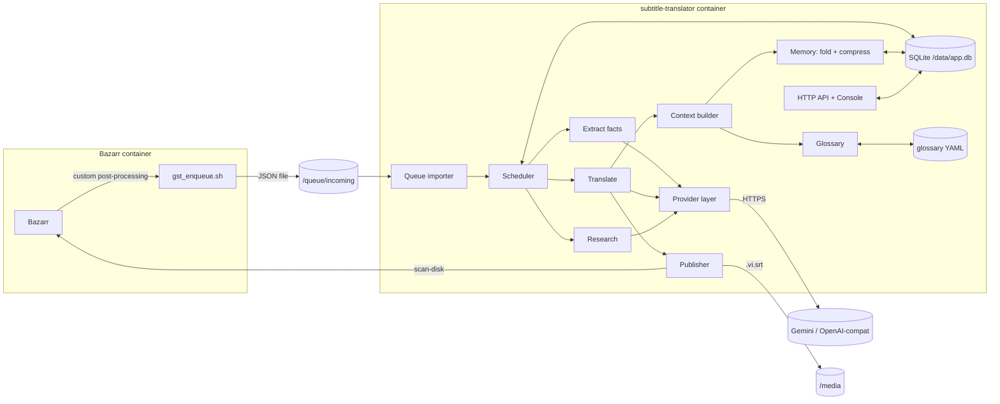
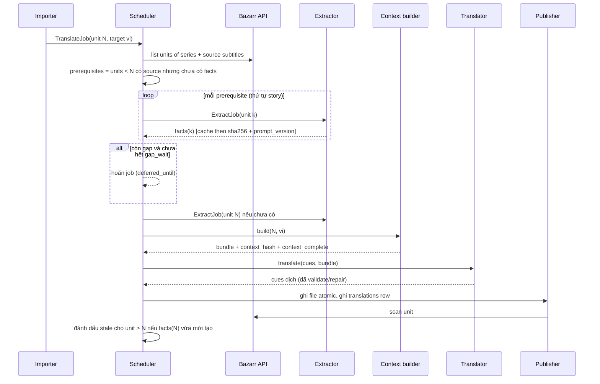

# ARCHITECTURE — LLM Subtitle Translator for Bazarr

> Trạng thái: **Draft v0.3** · 2026-11-11 · Hiện thực hoá [SPEC.md](SPEC.md)
> Tài liệu này mô tả kiến trúc **đích**. Kiến trúc hiện tại kế thừa từ upstream nằm ở [docs/ARCHITECTURE.md](../ARCHITECTURE.md).

---

## 1. Các quyết định chính (ADR rút gọn)

### ADR-1 · Không giữ kiến trúc CLI của `gemini-srt-translator` (gst)

**Quyết định:** Viết engine dịch riêng dưới dạng **thư viện Python**, worker gọi trực tiếp trong process. Không gọi `gst` qua subprocess, không fork gst.

**Lý do (từ code upstream):**
- gst là CLI tương tác: khi token vượt giới hạn nó dừng lại hỏi người dùng nhập batch size mới (`main.py:752-758`), tự cài signal handler, và `main.py` có 39 chỗ gọi `input`/`exit()` nằm ngay trong logic dịch → không dùng làm thư viện được nếu không sửa sâu.
- Worker hiện tại phải **đoán lỗi bằng cách tìm chuỗi trong stdout** (`"429"`, `"consecutive errors"`, `"expected … lines … got"`) — dễ vỡ mỗi khi upstream đổi câu log.
- Những thứ spec cần đều nằm *trong* lời gọi LLM của gst: mục glossary riêng (FR-4.3), context bundle nhiều lớp (FR-5.2), sửa cue lỗi có chọn lọc (FR-3.3), provider khác Gemini (FR-9). Fork gst để làm những thứ này = viết lại gần hết `main.py` (1.767 dòng).
- Phần thực sự có giá trị của gst nhỏ và tách được: bộ quy tắc trong system prompt, JSON schema `{i, text}`, `json-repair`, ý tưởng giảm batch thích ứng. gst là **MIT** ⇒ chép phần này vào engine kèm NOTICE.

**Hệ quả:** mất "miễn phí" các cải tiến tương lai của gst. Chấp nhận: phần mượn chỉ ~300 dòng, theo dõi thủ công changelog upstream theo tháng.

### ADR-2 · Một repo, fork từ `gemini-srt-translator-bazarr`, cấu trúc uv workspace

**Quyết định:** GitHub fork `kingzleshe/gemini-srt-translator-bazarr` → repo của bạn. Remote `upstream` trỏ về repo gốc. **Không** đưa gst vào repo (ADR-1 đã bỏ phụ thuộc runtime).

```
llm-subtitle-translator/            # fork
├─ packages/
│  └─ subcore/                      # engine thuần: không biết Bazarr, không biết HTTP
│     ├─ srt.py                     # parse/serialize, validate thẻ
│     ├─ providers/                 # base.py, gemini.py, openai_compat.py, fake.py
│     ├─ translate/                 # planner (split), prompt builder, repair loop
│     ├─ memory/                    # extract, fold, compress, context_hash
│     ├─ glossary/                  # YAML load/merge/validate, pending suggestions
│     └─ cli.py                     # `subcore translate file.srt --glossary g.yaml` (dịch tay, debug)
├─ apps/
│  └─ worker/                       # code hiện có của fork, refactor dần (package `llm-subtitle-worker`)
│     ├─ gst_worker/bazarr.py, tmdb.py  # giữ từ upstream
│     ├─ scheduler.py               # MỚI: story-order scheduling, prerequisite, gap
│     ├─ store.py                   # MỚI: SQLite
│     ├─ http/ + static/            # console hiện có + trang glossary/state
│     └─ worker.py
├─ bazarr-postprocess/gst_enqueue.sh  # giữ nguyên giao thức thả file
├─ docs/  (tài liệu upstream) + docs/design/ (SPEC.md, ARCHITECTURE.md đích)
└─ Dockerfile, docker-compose.yml
```

**Đã làm ở P0:** root `pyproject.toml` là *virtual workspace root* (không có `[project]`), một `uv.lock` chung. `subcore` dùng `src/` layout (`packages/subcore/src/subcore/`), build bằng `uv_build`, cài editable. `apps/worker` khai báo `package = false` (chạy dạng script, giữ nguyên import `gst_worker`). Image chỉ cài member `llm-subtitle-worker` và giữ layout runtime cũ (`/app/worker.py`, `/app/gst_worker`, `/app/static`).

**Vì sao một repo thay vì "monorepo chứa 2 repo clone + set upstream":**
- Sau ADR-1 chỉ còn **một** upstream có ý nghĩa (worker Bazarr). gst chỉ là nguồn tham khảo.
- Giữ 2 repo upstream trong monorepo (git subtree/submodule) chỉ đáng khi định **merge upstream thường xuyên**. Ở đây fork sẽ phân kỳ mạnh (thay toàn bộ lớp dịch, thêm SQLite) nên merge tự động gần như không khả thi; thực tế sẽ là **cherry-pick** các fix tích hợp Bazarr. Remote `upstream` là đủ cho việc đó.
- Tách `subcore` thành package riêng trong workspace để: test không cần Bazarr, có CLI dịch tay, và sau này có thể publish riêng nếu muốn.

**Quy tắc làm việc với upstream:** branch `upstream-sync` theo dõi `upstream/main`; mỗi tháng xem diff các file `bazarr.py`, `gst_enqueue.sh`, `queue*.py`, cherry-pick fix liên quan.

### ADR-3 · Gemini-first, không Gemini-only

**Hiện trạng:** cả hai repo gốc gắn chặt Gemini — gst dùng `google-genai`, thinking config, service tier; worker phân loại lỗi theo chuỗi lỗi Gemini, dropdown model lấy từ Gemini.

**Quyết định:** interface `Provider` mỏng, tự viết (không dùng LiteLLM/LangChain):

```python
class Provider(Protocol):
    caps: Capabilities   # max_input, max_output, structured_output, web_search, limits
    def generate(self, req: LLMRequest) -> LLMResponse: ...      # raise RateLimited / QuotaExhausted / Unavailable / BadOutput
    def count_tokens(self, req: LLMRequest) -> int: ...
```

- Adapter v1: `gemini` (google-genai), `openai_compat` (OpenRouter, Ollama, LM Studio, vLLM…), `fake` (test).
- Lỗi được **chuẩn hoá thành exception có kiểu** trong adapter ⇒ scheduler không bao giờ đọc chuỗi lỗi.
- Tính năng phụ thuộc năng lực tự suy giảm: không `web_search` → bỏ research; context nhỏ → planner chia phần; không `structured_output` → JSON mode + json-repair + validate chặt hơn.
- Không dùng LiteLLM vì: chỉ cần 2–3 adapter; các tính năng cần (structured output + grounding + thinking) là chỗ LiteLLM hay "rò" khác biệt giữa provider; thêm một lớp khó debug.

**Phần vẫn gắn Gemini có chủ đích:** giá trị mặc định (model, quota free tier), research dùng Google Search grounding.

### ADR-4 · Một container, một process

**Quyết định:** Một image, một container `subtitle-translator`, một process Python: thread worker + HTTP server (như hiện tại). State trong volume `/data` (SQLite + glossary YAML + backup). Script enqueue vẫn chạy trong container Bazarr.

**Lý do:**
- Quota LLM là nút thắt, không phải CPU ⇒ thêm worker song song không tăng tốc mà chỉ tăng 429.
- SQLite chỉ có một writer ⇒ đơn giản, không cần DB server.
- Homelab: ít thứ để update/backup.

**Khi nào tách:** (a) dùng LLM local → thêm container `ollama` riêng (provider `openai_compat` trỏ tới); (b) nhiều người dùng/nhiều instance Bazarr → tách worker và console, đổi SQLite sang Postgres. Cả hai không thuộc v1.

### ADR-5 · Lưu trữ: SQLite cho máy, YAML cho người

| Dữ liệu | Nơi lưu | Lý do |
|---|---|---|
| Glossary (người viết/duyệt) | `/data/series/<series_key>/glossary.<lang>.yaml` | Sửa tay bằng editor, diff được, backup bằng copy. |
| Đề xuất `pending` | SQLite `suggestions` | Máy sinh, cần trạng thái duyệt. |
| Facts, story state cache, translations, jobs | SQLite `/data/app.db` | Cần truy vấn ("facts của mọi unit < N", "bản dịch stale"). |
| Queue đầu vào | `/queue/incoming/*.json` (giữ giao thức cũ) | Script trong Bazarr không đổi. Worker import file → bảng `jobs` rồi xoá file. |

**[Đổi so với SRS]** SRS đề xuất JSON/TXT trước, SQLite sau. Bỏ giai đoạn file: truy vấn staleness/prerequisite trên file JSON sẽ phải viết lại khi lên SQLite.

### ADR-6 · Memory: facts theo tập + fold xác định, không dùng memory framework

**Quyết định:** event-sourcing đơn giản. Mỗi unit có **facts bất biến** (trích từ source subtitle); story state @N là **phép fold xác định** trên facts các unit < N. Chỉ phần *nén tóm tắt cũ* mới dùng LLM, và được cache.

**Vì sao giải quyết được ví dụ "tập 1 người yêu, tập 6 kẻ thù, dịch tập 6 trước":**

| | Snapshot tích luỹ (đề xuất trước) | Facts theo tập + fold (thiết kế này) |
|---|---|---|
| Tập 1 dịch sau tập 6 có bị nhiễm "kẻ thù"? | Không (chỉ lấy snapshot < 1) | Không (fold rỗng) |
| Tập 6 dịch đầu tiên có biết quan hệ ở tập 1–5? | **Không** — snapshot trước 6 chưa tồn tại | **Có** — prerequisite trích facts 1–5 từ source trước |
| Tập 7 sau khi tập 1–5 được dịch muộn? | Snapshot tập 6 thiếu 1–5 → **sai dây chuyền** | Fold lại từ facts, luôn đúng |
| Nguồn của memory | Bản dịch (phụ thuộc thứ tự dịch) | Source subtitle (không phụ thuộc thứ tự) |

Lỗ hổng thật của đề xuất trước là chiều ngược lại và lỗi dây chuyền; thiết kế này loại bỏ cả hai vì facts không phụ thuộc thứ tự dịch.

**Correction trong mô hình này:** glossary (gồm correction scope `forward`/`series`) là lớp **ghi đè** đặt trên fold, không sửa facts. Facts vẫn là "máy thấy gì trong phụ đề gốc"; người chỉ sửa cách dịch. Nhờ vậy correction không bao giờ bị lần trích xuất lại xoá mất.

**Vì sao không Mem0/Zep/LangGraph/LlamaIndex** (đã phân tích ở vòng trước): memory nhỏ (≤ 8k token) nên không cần retrieval; cần phiên bản theo *story order* chứ không theo thời gian thực; quota thấp không chịu được ingestion nhiều lời gọi; glossary phải sửa tay. Mem0 ghi đè (mất lịch sử), Zep cloud vi phạm NFR-6, Graphiti nặng; LangGraph/LlamaIndex trùng với scheduler.

### ADR-7 · Duyệt / correction / dịch lại nằm trong console của worker

**Quyết định:** Mở rộng console tĩnh sẵn có (`static/`, vanilla JS không build step, cùng process, cùng port 6789). Không làm UI riêng.

| Phương án | Đánh giá |
|---|---|
| **Console worker (chọn)** | Cùng process, đọc thẳng SQLite + YAML; đã có khung điều hướng, settings, logs; không thêm container/port. |
| UI của Bazarr | Bazarr không có cơ chế plugin/extension cho UI ⇒ không chèn được nút. Chỉ dùng Bazarr cho việc nó đã làm: hook + scan. |
| Plugin Jellyfin/Plex ("báo câu sai" ngay trong player) | Trải nghiệm tốt nhất nhưng mỗi player một plugin, ngôn ngữ khác (C#/…), gắn với player bạn đang dùng. Ngoài v1; API ở mục 5 đủ để làm sau. |
| SPA riêng (React…) | Thêm build pipeline + container, trùng chức năng console. |
| Chỉ sửa file YAML bằng tay | Vẫn được hỗ trợ (YAML là nguồn sự thật), nhưng không đủ cho duyệt có bằng chứng, tìm cue theo timecode, diff/hoàn tác. |

**Trang mới:**
- **Review** — hộp duyệt `pending` (FR-11.1), badge trên nav.
- **Library** — series → tập; mỗi tập: trạng thái bản dịch (`current`/`stale`/`incomplete`), lọc theo trạng thái.
- **Episode** — bảng song song gốc–dịch, ô "nhảy tới timecode", tìm text; chọn cue → thêm correction / sửa trực tiếp; nút **Dịch lại** (form FR-11.3.2); tab **Lịch sử** (các phiên bản, diff, hoàn tác); tab **Context** (story state @N đã dùng để dịch — để hiểu vì sao model xưng hô như vậy).
- **Glossary** — sửa theo series; lưu xuống YAML; hiện số bản dịch sẽ stale.

Yêu cầu UI: responsive (điện thoại), không phụ thuộc CDN (homelab có thể offline).

**Xác thực:** Basic Auth bắt buộc mặc định (SPEC NFR-5) — một middleware trong HTTP handler chặn **mọi** request trước khi route (static + `/api/*`), không có đường dẫn ngoại lệ. Trình duyệt tự nhớ credential nên console tĩnh không cần màn hình đăng nhập; script/Home Assistant gửi header `Authorization`. Credential chỉ đọc từ env lúc khởi động (`CONSOLE_USER`, `CONSOLE_PASSWORD`, `CONSOLE_AUTH=off` để tắt), không nằm trong `RuntimeContext` dưới dạng có thể serialize ra API.

---

## 2. Tổng quan thành phần



---

## 3. Luồng xử lý

### 3.1 Từ job đến bản dịch



### 3.2 Scheduler

- Hàng đợi ưu tiên: `ExtractJob` > `TranslateJob`; trong cùng series theo story order tăng dần; giữa các series theo thời gian vào.
- `settle_window` (kế thừa, mặc định 10 phút) cho phép season pack vào đủ trước khi chạy ⇒ đa số trường hợp các tập được xử lý theo đúng thứ tự mà không cần chờ gap.
- Một job chạy tại một thời điểm (ADR-4); rate limiter nằm trong provider layer.
- Trạng thái job: `queued → waiting_prereq → running → done | failed | deferred(quota|gap)`.
- Hết quota ngày (`QuotaExhausted`) ⇒ cả queue `paused_until = reset_time` của provider/model đó; job khác dùng provider khác vẫn chạy.

### 3.3 Translator (engine `subcore.translate`)

1. **Planner:** ước tính output token = token(text nguồn) × hệ số ngôn ngữ (vi ≈ 1.3, cấu hình được). Nếu ≤ 80% `max_output` ⇒ 1 phần. Ngược lại chia tại các khoảng lặng lớn nhất giữa cue, mỗi phần ≥ 100 cue.
2. **Prompt** (thứ tự = ưu tiên giảm dần):
   ```
   SYSTEM
   1. Core rules            (mượn từ gst: giữ thẻ, không gộp/tách cue, trả JSON {i,text})
   2. Target-language rules (vi: hướng dẫn xưng hô theo quan hệ/tuổi/vai vế)
   3. Glossary — LOCKED     (terms, characters, address_rules đang hiệu lực tại unit N)
   4. Story so far          (arc tóm tắt + K tập gần nhất)
   5. Relationship state @N (cặp nhân vật → quan hệ, thân mật, vai vế)
   6. This episode          (facts unit N: thay đổi quan hệ kèm timecode → cue index)
   7. Metadata              (TMDB title/overview)
   USER
   - Toàn bộ cue nguồn của unit (để có ngữ cảnh), đánh dấu dải cần dịch nếu có nhiều phần
   ```
   Timecode trong mục 6 được quy đổi sang **cue index** trước khi đưa vào, vì model không nhìn thấy timecode.
3. **Validate** theo FR-3.2 → **repair**: gom các `i` lỗi, gửi lại chỉ những cue đó + 5 cue lân cận làm ngữ cảnh, tối đa 2 vòng → nếu vẫn lỗi, tăng số phần (planner ×2) → fail.

### 3.4 Memory (`subcore.memory`)

**Facts schema** (output của extractor, structured output, không phụ thuộc ngôn ngữ đích):

```json
{
  "characters": [{"name": "Alice", "aliases": ["Al"], "gender": "f", "age_hint": "20s", "role": "lead"}],
  "relationship_events": [{
    "a": "Alice", "b": "Bob",
    "relation": "romantic|family|friend|rival|enemy|professional|stranger",
    "intimacy": 0, "hierarchy": "a_above|equal|b_above",
    "cue": 412, "evidence": "I never want to see you again.", "confidence": 0.7
  }],
  "terms": [{"source": "Kyber crystal", "kind": "object"}],
  "summary": "≤ 150 từ"
}
```

**Fold @N** (thuần Python, xác định): characters = hợp theo tên/alias; relationship = sự kiện cuối cùng của mỗi cặp (không định hướng) trước N; terms = hợp + đếm số tập xuất hiện; summaries = danh sách theo story order.

**Compress:** nếu fold vượt budget ⇒ LLM nén summaries các tập cũ thành arc summary; cache theo `(series, up_to_unit, hash(facts used))`.

**context_hash** = hash(facts_hash các unit < N, facts_hash(N), glossary version, prompt_version, model). Thay đổi bất kỳ ⇒ bản dịch cũ `stale`.

### 3.5 Research (`subcore.glossary.research`)

- Kích hoạt: series mới, hoặc có term xuất hiện ≥ 2 tập chưa có trong glossary.
- Lời gọi 1 (có Google Search, không schema): "Bản dịch tiếng Việt phổ biến của các tên/thuật ngữ sau trong *<series>*, kèm nguồn".
- Lời gọi 2 (model rẻ, structured output): chuyển kết quả thành `[{source, target, sources[], confidence}]` → bảng `suggestions` (pending).
- Lấy URL nguồn từ grounding metadata của response, không tin URL model tự viết.

---

## 4. Mô hình dữ liệu (SQLite)

```sql
series(id PK, key UNIQUE, title, tvdb_id, tmdb_id, stale_policy /* flag|ignore */, specials_anchor_json)
units(id PK, series_id FK NULL, movie_key NULL, season, episode, bazarr_id, video_path,
      UNIQUE(series_id, season, episode))
source_subs(id PK, unit_id FK, lang, path, sha256, seen_at)
facts(id PK, unit_id FK, source_sha256, prompt_version, model, json, tokens_in, tokens_out, created_at,
      UNIQUE(unit_id, source_sha256, prompt_version))
summaries_cache(id PK, series_id FK, up_to_unit, input_hash UNIQUE, text, created_at)
translations(id PK, unit_id FK, target_lang, version, output_path, backup_path, sha256,
             context_hash, context_complete, missing_units_json,
             trigger /* auto|retranslate|cue_edit|revert */, parent_version,
             status /* current|stale|superseded */, created_at)
suggestions(id PK, series_id FK, target_lang, kind /* term|address_rule|character */,
            payload_json, evidence_json, sources_json, auto_accepted,
            status /* pending|accepted|rejected */, decided_at, created_at)
corrections(id PK, unit_id FK, target_lang, kind /* term|address|note|cue_edit */,
            payload_json /* cue_edit: {cue, text} */, created_at, active)
            -- chỉ scope=episode; scope forward/series ghi vào glossary YAML
jobs(id PK, kind /* translate|extract|research|retranslate */, unit_id, target_lang,
     priority, params_json /* range, correction ids */, state, attempts,
     deferred_until, error, created_at, updated_at)
llm_calls(id PK, job_id FK, provider, model, task, tokens_in, tokens_out, latency_ms, outcome, at)
```

"File do hệ thống tạo" (FR-8.1, NFR-4) = có dòng trong `translations` với `output_path` trùng và sha256 khớp.
Nếu sha256 file đang nằm trên đĩa **không** khớp phiên bản `current` (người dùng sửa tay bằng editor khác), hệ thống coi đó là một phiên bản ngoài: backup nó trước khi dịch lại và hiện cảnh báo trên trang Episode.

---

## 5. HTTP API bổ sung (cho FR-11)

| Method & path | Việc |
|---|---|
| `GET /api/review?series=` | Danh sách `pending` |
| `POST /api/review/{id}/accept` (body tuỳ chọn: payload đã sửa) · `/reject` | Duyệt |
| `GET /api/library/series` · `GET /api/library/series/{id}/units` | Library |
| `GET /api/units/{id}/cues?lang=vi&at=00:23:10&q=` | Bảng gốc–dịch, nhảy theo timecode, tìm |
| `GET /api/units/{id}/context` | Story state + glossary đã dùng cho bản dịch hiện tại |
| `POST /api/units/{id}/corrections` | Thêm correction (`kind`, `scope`, payload). `cue_edit` → tạo phiên bản mới ngay |
| `POST /api/units/{id}/retranslate` | `{range?: {cues|time}, correction_ids?, new_corrections?}` → job ưu tiên cao |
| `GET /api/units/{id}/versions` · `GET …/versions/{v}/diff?against=` · `POST …/versions/{v}/revert` | Lịch sử, diff, hoàn tác |
| `GET/PUT /api/series/{id}/glossary?lang=vi` | Đọc/ghi YAML (kiểm schema, ghi atomic) |

---

## 6. Cấu hình

- `.env`: đường dẫn, cổng, secrets (`GEMINI_API_KEY*`, `OPENAI_COMPAT_*`, `BAZARR_API_KEY`, `TMDB_API_KEY`, `CONSOLE_USER`, `CONSOLE_PASSWORD`; `CONSOLE_AUTH=off` để tắt Basic Auth).
- `/data/config.yaml` (sửa qua console): providers, model theo task (`translate`, `extract`, `summarize`, `research`), giới hạn RPM/TPM/RPD, `settle_window`, `gap_wait`, `stale_policy` mặc định, budget context, ngôn ngữ nguồn/đích.

---

## 7. Lộ trình

| Phase | Nội dung | Kết quả kiểm chứng |
|---|---|---|
| **P0** | Fork, chuyển sang uv workspace, CI xanh, chưa đổi hành vi | Test upstream vẫn pass |
| **P0b** | Basic Auth bắt buộc cho console + API (NFR-5) | Request không có/sai credential → 401; thiếu env → 503; `CONSOLE_AUTH=off` → mở; mật khẩu không xuất hiện trong log |
| **P1** | `subcore`: srt, provider gemini + fake, translator (planner/prompt/validate/repair), glossary YAML, CLI | Tiêu chí nghiệm thu 3, 4, 5 (qua CLI) |
| **P2** | Worker dùng `subcore` thay `gst`; SQLite (`jobs`, `translations` có version/backup, `llm_calls`); rate limiter | Chạy thật với Bazarr, bỏ phụ thuộc gst; tiêu chí 8 |
| **P3** | Console: Library, Episode (gốc–dịch, timecode), correction, dịch lại theo dải, lịch sử/hoàn tác | Tiêu chí 7 |
| **P4** | Memory: extractor, fold, scheduler prerequisite/gap/stale; tab Context | Tiêu chí 1, 2 |
| **P5** | Đề xuất (FR-6) + research grounding + Review inbox; provider `openai_compat` | FR-6, FR-7, FR-9.1, FR-11.1 |

P1 dùng được ngay bằng CLI trước khi động vào worker — cách nhanh nhất để đánh giá chất lượng dịch với glossary thật. P3 đứng trước memory vì correction + dịch lại là "lưới an toàn" chất lượng cần có trước khi tự động hoá thêm.

---

## 8. Rủi ro

| Rủi ro | Giảm thiểu |
|---|---|
| Trích quan hệ từ SRT không có người nói kém chính xác | `confidence` + đề xuất pending + glossary người viết luôn thắng; đo trên 2–3 series quen thuộc ở P4 trước khi tin. |
| Prerequisite làm tốn quota khi lần đầu thêm series dài (vd 100 tập) | Extract dùng model rẻ nhất; giới hạn `max_prereq_per_day`; cho phép bật memory theo từng series. |
| Fork phân kỳ, khó lấy fix Bazarr của upstream | Giữ `bazarr.py`/`gst_enqueue.sh` ít sửa nhất có thể; sync hàng tháng (ADR-2). |
| Model đổi hành vi structured output | Adapter + test hợp đồng với fake; validate chặt ở engine, không tin provider. |
| Console ghi được mà không có auth | Basic Auth bật mặc định từ P0b (NFR-5); tắt phải tường minh. Basic Auth không mã hoá ⇒ khuyến nghị chỉ expose trong LAN / sau reverse proxy có TLS. |
