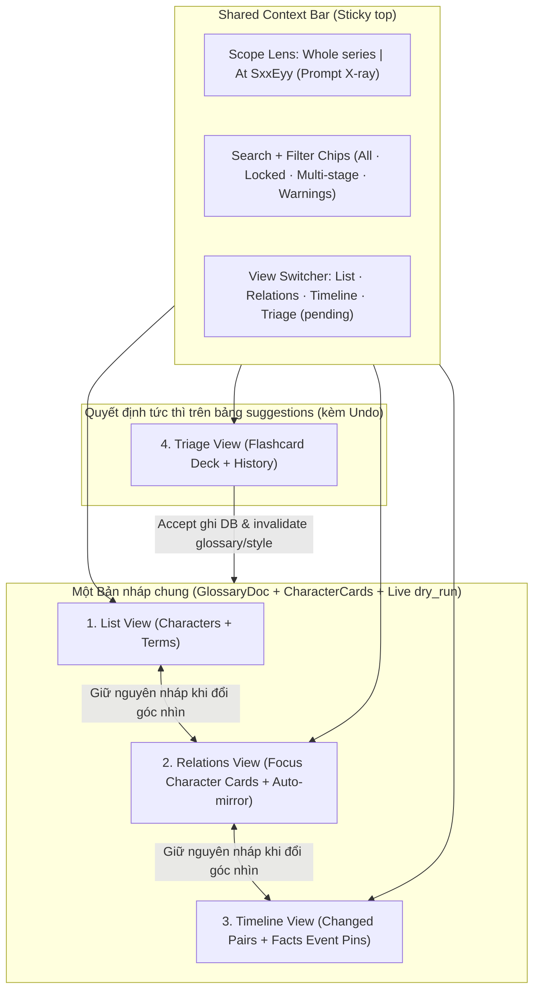

# P20 (v1.1) — Unified Glossary Workspace (4 Góc nhìn)

> Trạng thái: **Draft v0.1 (chờ review & phản biện thiết kế)** · 2026-11-27 · Quyết định: [docs/DECISIONS.md](../DECISIONS.md) D-06; liên kết từ [UX.md](UX.md) §8 và [PLAN.md](../../PLAN.md) P20.
> Phạm vi: **v1.1 / P20** (chỉ bắt đầu **sau khi đóng trọn P19**). Mục tiêu đầu tiên ở phiên kế tiếp là **review và phản biện chéo** toàn bộ thiết kế P19a/P19b/P19d (`SPEC.md` v0.24, `UX.md` v0.24, `wireframe-v2.md` v2.4) cùng tài liệu P20 này trước khi viết code.

---

## 1. Quyết định phạm vi & Cấu trúc Tab trên trang Series

1. **Vị trí trên lộ trình:** thuộc **v1.1 / P20**, tách biệt hoàn toàn để không làm phình P19.
2. **Gộp hẳn 3 tab thành 1 tab `Glossary` duy nhất ngay từ P20a:**
   - Thanh tab của trang Series rút từ 6 tab (`Episodes · Style · Glossary · Characters · Context · Suggestions`) xuống còn **4 tab**:
     `[ Episodes ]  [ Style ]  [ Glossary (badge pending) ]  [ Context ]`
   - Bên trong tab `Glossary` là **Shared Context Bar** + **View Switcher** chuyển giữa 4 góc nhìn trên cùng dữ liệu của series và ngôn ngữ đích đang chọn:
     `[ List ]  [ Relations ]  [ Timeline ]  [ Triage (N) ]`
   - *Cầu nối không đứt luồng ở P20a:* vì gộp cả 3 tab ngay ở P20a trong khi Flashcard Triage làm ở P20b, ở P20a góc nhìn `Triage (N)` nhúng nguyên `<ReviewInbox seriesId={storedId} embedded />` sẵn có (0 mất tính năng), sau đó P20b nâng cấp nội dung góc nhìn đó thành Flashcard Deck + chuyển đổi History.
   - Với **Phim lẻ (`MovieGlossary`)**: chỉ hiện `List` và `Relations` (phim lẻ là một unit đơn nên không có `Timeline` nhiều tập và không có `Suggestions`/`Triage`).

---

## 2. Phản biện bản concept gốc & 7 Cải tiến theo ràng buộc thật của dự án

Thiết kế giữ trọn tinh thần của concept gốc (một nguồn dữ liệu gốc – nhiều lát cắt nhìn, *Focus Matrix* lấy một nhân vật làm tâm, và *Flashcard Triage* duyệt nhanh cho giai đoạn Bootstrap), đồng thời sửa **7 điểm va chạm** với kiến trúc thật (`ADR-14`, `P18a`, `P19b/c`) và môi trường cảm ứng **iPad cầm dọc ~820 px trong Organizr iframe**:

| # | Điểm trong concept gốc | Va chạm với hệ thống thật / iPad | Thiết kế đã cải tiến cho P20 |
|---|---|---|---|
| **1** | **Global Scope: Lọc theo Tập** chỉ để lọc danh sách hiển thị | Sau P19c (`scoped_rules` + `for_episode`), prompt dịch một tập chỉ nhận các rule có mặt trong cast của tập đó. Admin hiện **không thấy được rule nào thực sự đi vào prompt của tập**. | Nâng cấp thành **Scope X-ray Lens** (`Whole series` \| `At S02E04 · Dinner Out`): lọc đúng bằng quy tắc `for_episode` + `scoped_rules` của P19c (0 model call), hiện rõ `Active in S02E04 (11/76)` kèm công tắc `Show out-of-scope` làm mờ các mục bị lọc ra để gỡ lỗi nhanh. |
| **2** | Cột **`Tự xưng mặc định`** cho từng nhân vật | Trong tiếng Việt (đặc biệt sitcom gia đình như *Malcolm*, `UX-FEEDBACK-03` §4b), đại từ tự xưng phụ thuộc hoàn toàn vào người nghe (`con`, `em`, `anh`, `tớ`). Đặt "tự xưng mặc định" toàn cục khiến model dễ rơi về đại từ ngang hàng sai vai vế ở cảnh đông người. | **Không** đặt cột tự xưng mặc định toàn cục. Chỉ cho phép trường tuỳ chọn **`Solo / audience self-pronoun`** bên trong chi tiết nhân vật (phục vụ độc thoại nội tâm, phá bức tường thứ 4 nói với khán giả, hoặc danh xưng cố định kiểu cổ trang *"Bổn vương"*). Xưng hô đối thoại giữ nghiêm theo cặp `self–other` ở `Relations`. |
| **3** | **Double-click sửa ô kiểu Excel, Hover hiện `+2 aliases`, Hover cái kéo `Split`, Popover** | iPad không có hover, double-tap gây zoom/chọn chữ, bàn phím ảo iOS che nửa màn hình làm nhảy bảng inline, và Popover tự đóng khi chạm lệch (`UX.md` §3.6, §6.5). | **Đáp ứng hai khổ màn hình:** dưới `1024 px` (iPad dọc ~820 px), `List` dùng hàng thẻ gọn 2 dòng — chạm mở **Bottom Sheet** có `[ < Prev ] [ Next > ]` (giống sửa cue `3a`); từ `1024 px` trở lên (khổ ngang/desktop) mới bung bảng nhiều cột sửa trực tiếp bằng 1 chạm + `Tab`/`Enter`. Mọi thao tác phụ dùng nút ≥ 44 px và Bottom Sheet, không dùng Popover hay Hover. |
| **4** | **Swap / Mirror** tự suy chiều ngược kiểu từ điển ("Sư phụ → Đồ nhi") | Schema thật (`subcore.glossary.AddressRule`) lưu mỗi chiều là cặp `self–other` (`a_to_b = "con–mẹ"`, `b_to_a = "mẹ–con"`). Lỗi phổ biến nhất là người dùng gõ lộn chiều (`mẹ–con` ở cả hai ô). | Thêm **Chip preset cặp đối xứng 1 chạm** (`con–mẹ`, `em–anh`, `em–cô`, `tớ–cậu`, `cháu–bác`…) cộng nút **`[ ⇄ Auto-mirror ]`**: khi nhập `a_to_b = "em–anh"`, tách theo dấu `–`/`-` để tự điền gợi ý `b_to_a = "anh–em"` (thuần chuỗi, 0 model call, đúng cho đại đa số cặp tiếng Việt). |
| **5** | **Interactive Graph (`Chế độ B`)** 10–15 nút có mũi tên hai chiều | Trên khung 820 px dọc, đồ thị mạng nhện 15 nút gắn nhãn tiếng Việt hai chiều chắc chắn chồng chữ, cạnh nối `< 44 px` không bấm được bằng tay, và kéo thêm thư viện đồ thị nặng. | **Loại bỏ đồ thị lực tự do (force-graph).** Ở khổ dọc chỉ dùng **Focus Matrix** (kết hợp `Scope: At SxxEyy` đã thu gọn còn 5–8 nhân vật trong tập). Ở khổ ngang `≥ 1024 px`, cung cấp thêm chế độ **Matrix Grid** (bảng ô vuông cho nhóm cast chính, mỗi ô ≥ 44 px, CSS thuần không phụ thuộc thư viện ngoài). |
| **6** | **Timeline Swimlane** trục ngang `Ep 1 … Ep 24` + **Drag Edge** highlight câu thoại lệch | Series dài như *Malcolm* có **151 tập** (7 mùa) → 151 cột trên 820 px chỉ rộng ~4 px/tập; quét SRT tìm câu lệch khi kéo cạnh sẽ gây bão đọc đĩa (`P18a`) và sai vì SRT không có nhãn người nói (`FR-4.3`). | **(a)** Mặc định lọc **`Changed pairs only`** (ẩn các cặp 1 giai đoạn cố định suốt series). **(b)** Thu phóng 2 cấp: `All Seasons` → `Season k`. **(c)** Thay kéo thả chuột bằng nút chạm ≥ 44 px **`[ + Split stage ]`** / **`[ Move boundary… ]`**, gắn sẵn **Event Pins `📍`** đọc từ `facts.relationship_events` có `confidence >= 0.8` trong SQLite (0 call). **(d)** Đổi mốc chỉ chạy `dry_run` băm nhẹ để báo tập `Will become Stale`; dịch lại đi qua `EstimateSheet`. |
| **7** | **Triage View** chỉ phím tắt `A / E / I` và trộn chung cơ chế lưu | `Terms/Address/Characters` sửa trên một bản nháp chung (`GlossaryDoc` + `CharacterCards`), còn `Suggestions` ghi quyết định tức thì từng mục vào bảng `suggestions`. Ngoài ra trên iPad không luôn gắn bàn phím cứng, và `Ignore` dễ nhầm giữa *Bỏ qua tạm* với *Reject vĩnh viễn*. | **(a)** View 1–3 dùng chung **một bản nháp Workspace** + 1 thanh sticky `Save / Discard` dính đáy; chuyển sang View 4 khi đang có nháp chưa lưu sẽ hỏi `Save / Discard` trước để `Accept` không ghi đè nháp. **(b)** Đáy thẻ `Triage` có 4 nút cảm ứng ngón cái cao ≥ 48 px (`Reject · Edit · Skip · Accept`) song song phím tắt `R / E / Space / A` (`Z` = Undo). **(c)** Sắp thứ tự thẻ **Characters → Forms of address → Terms** để duyệt xong tên + `aliases` ở bước 1 tự chuẩn hoá luôn các thẻ xưng hô ở bước 2. |

---

## 3. Kiến trúc trạng thái & Nguồn dữ liệu



### Nguồn dữ liệu theo phần (đối chiếu `docs/API.md`):
- **Dữ liệu sẵn có (không đổi API ở P20a MVP nếu chưa bật Scope X-ray theo cast):**
  - `GET/PUT /api/series/{id}/glossary` (`dry_run`), `GET/PUT /api/series/{id}/style` & `PUT .../cards`, `POST .../cards/delete`
  - `GET /api/suggestions?series={storedId}`, `POST /api/suggestions/{id}/accept|reject|undo`, `POST /api/suggestions/bulk`
  - `GET /api/catalog/series/{id}` (danh sách mùa/tập cho bộ chọn `At SxxEyy`)
- **API nhỏ cần thêm theo từng bước:**
  - **P20a (`Scope: At SxxEyy`):** endpoint đọc nhẹ `GET /api/series/{id}/glossary/scope?lang=&unit_id=` (0 model call: trả tập tên `cast` của tập từ `StoryMemory`/TMDB cache và danh sách chỉ số `terms`/`address_rules`/`characters` active qua `for_episode` + `scoped_rules`), để UI không phải tự đoán `cast` ở phía trình duyệt.
  - **P20c (`Timeline` Event Pins):** endpoint đọc nhẹ `GET /api/series/{id}/memory/events` (gộp các `relationship_events` đã lưu trong bảng `facts` có `confidence >= 0.8` kèm `season`, `episode`, `cue`, `detail`, 0 model call) để vẽ cờ `📍` trên trục thời gian mà không phải gọi N request `GET /api/units/{id}/facts`.

---

## 4. Wireframe chi tiết (Khổ dọc ~820 px là chính · Khổ ngang ≥ 1024 px mở rộng)

### 4.0. Khung chung của tab `Glossary` (`#/series/:id/glossary?view=...`)

```text
+------------------------------------------------------------------------------+
| [ < Library ]   Malcolm in the Middle                    Target [ vi v ]     |
| (Auto-request · Story memory · Bootstrap bar như wireframe v2.4 mục 2)       |
+------------------------------------------------------------------------------+
| [ Episodes ]    [ Style ]    [ Glossary (12) ]    [ Context ]                |
+------------------------------------------------------------------------------+
| [ Research terms (4) ]                         [ Clean up (3) ] [ More ⋯ ]   |
|   (More ⋯ mở Bottom Sheet: Import YAML · Export YAML · Copy · History)       |
+------------------------------------------------------------------------------+
| Scope  [ At S02E04 · Dinner Out (11 active) v ]  [ 🔍 Search names, terms… ] |
| View   [ List (42)  |  Relations (36)  |  Timeline (3)  |  Triage (12) ]     |
+------------------------------------------------------------------------------+
|                         < NỘI DUNG VIEW ĐANG CHỌN >                          |
+------------------------------------------------------------------------------+
| [● Unsaved changes]  Saving flags 6 episodes stale.  [ Discard ]   [ Save ]  |
| (sticky safe-area bottom bar; dùng chung cho List, Relations và Timeline)    |
+------------------------------------------------------------------------------+
```

---

### 4.1. View 1 — `List` (Characters + Terms)

**Khổ dọc (~820 px):**

```text
+------------------------------------------------------------------------------+
| Filter: ( All ) ( Characters 14 ) ( Terms 28 ) ( 🔒 Locked ) ( ⚠ Warnings )  |
| [x] Only active in S02E04 (11)     Bulk (2): [ Lock ] [ Window… ] [ Delete ] |
+------------------------------------------------------------------------------+
| [v] CHARACTERS (5 in S02E04 · 9 outside episode)             [ + Character ] |
| +--------------------------------------------------------------------------+ |
| | [ ] Lois                         → Lois                       [f] [Card] | |
| |     Mother, strict · Voice: sharp, fast · 6 address pairs       [ Edit ] | |
| +--------------------------------------------------------------------------+ |
| | [ ] Caroline Miller              → Caroline Miller            [f]        | |
| |     Aliases: Carolyn Miller · Krelboyne teacher · 1 pair        [ Edit ] | |
| +--------------------------------------------------------------------------+ |
|                                                                              |
| [v] TERMS (6 in S02E04 · 22 outside episode)                      [ + Term ] |
| +--------------------------------------------------------------------------+ |
| | [x] Krelboyne          → lớp năng khiếu Krelboyne   [🔒 Locked] [ Edit ] | |
| |     Note: gifted class · Whole series                                    | |
| +--------------------------------------------------------------------------+ |
| | [x] Marlin Academy     → Học viện Quân sự Marlin    [🔒 Locked] [ Edit ] | |
| |     From S01E02 · Also matches: Marlin                          [ Edit ] | |
| +--------------------------------------------------------------------------+ |
+------------------------------------------------------------------------------+
```

- Chạm `[ Edit ]` mở Bottom Sheet có `[ < Prev ] [ Next > ]` (giữ ô nhập phía trên bàn phím ảo iOS).
- **Khổ ngang (`≥ 1024 px`):** mở rộng thành bảng 5 cột (`[ ] · Source (+Aliases badge) · Target · Voice / Note · Window / Locked`), chạm 1 lần vào ô chữ để sửa nhanh, `Tab`/`Enter` di chuyển giữa các hàng.

---

### 4.2. View 2 — `Relations` (Focus Matrix & Auto-mirror `self–other`)

**Khổ dọc (~820 px):**

```text
+------------------------------------------------------------------------------+
| Focus character (cast of S02E04 first):                                      |
| (● Malcolm · 6 ) ( Lois · 5 ) ( Hal · 5 ) ( Spangler · 2 ) ( Stevie · 3 ) →  |
+------------------------------------------------------------------------------+
| MALCOLM'S RELATIONSHIPS IN S02E04                        [ + Add partner… ]  |
|                                                                              |
| +--------------------------------------------------------------------------+ |
| | Malcolm  ⇄  Lois                                                         | |
| |   Malcolm → Lois : [ con–mẹ         ]   (self–other)                     | |
| |   Lois → Malcolm : [ mẹ–con         ]   [ ⇄ Auto-mirror ]                | |
| |   Presets        : ( con–mẹ ) ( em–anh ) ( em–cô ) ( tớ–cậu )            | |
| |   Window: Whole series                                        [ Delete ] | |
| +--------------------------------------------------------------------------+ |
| | Malcolm  ⇄  Reese                                                        | |
| |   Malcolm → Reese: [ em–anh         ]                                    | |
| |   Reese → Malcolm: [ anh–em         ]   [ ⇄ Auto-mirror ]                | |
| |   Window: Whole series                                        [ Delete ] | |
| +--------------------------------------------------------------------------+ |
| | [!] Malcolm  ⇄  Mom                         [ Generic address warning ]  | |
| |   "Mom" is a generic form of address. Replace with a proper name         | |
| |   (e.g. Lois) or delete this rule.                            [ Delete ] | |
| +--------------------------------------------------------------------------+ |
+------------------------------------------------------------------------------+
```

- **Khổ ngang (`≥ 1024 px`):** cột trái cố định `240 px` (danh sách nhân vật + số cặp + huy hiệu cảnh báo), cột phải hiển thị danh sách thẻ 2 chiều kèm nút chuyển **`[ Cards | Matrix Grid ]`** (bảng ô vuông cho nhóm cast chính, ô `(A, B)` hiện `a_to_b`, chạm ô mở hộp sửa cặp `A ⇄ B`).

---

### 4.3. View 3 — `Timeline` (Swimlane cặp đổi giai đoạn + Event Pins từ `facts`)

**Khổ dọc (~820 px):**

```text
+------------------------------------------------------------------------------+
| Filter: [● Changed pairs (2) | All pairs (36) ]   Zoom: [ S1 | S2 | All ]    |
+------------------------------------------------------------------------------+
| SEASON 1 (E01 ─────────────────────────── E16)                               |
| Story pins:       📍E06 00:32 Betrayal           📍E14 Reconciliation        |
+------------------------------------------------------------------------------+
| Alice  ⇄  Bob                                             [ + Split stage ]  |
|   E01 ────── E05 │ E06 (00:32:10) ─────────── E13 │ E14 ──────────────►      |
|  [  anh–em /     │ [      tôi–cô /               │ [   chồng–vợ /           |
|     em–anh    ]  │        cô–tôi              ]  │     vợ–chồng          ]  |
|                                                                              |
|   1. Start → S01E06 00:32:10 : anh–em / em–anh                    [ Edit ]   |
|   2. S01E06 00:32:10 → S01E14: tôi–cô / cô–tôi                    [ Edit ]   |
|   3. From S01E14             : chồng–vợ / vợ–chồng                [ Edit ]   |
|                                                                              |
|   [i] Changing boundary 2 → S01E05 flags S01E05 Stale (0 calls now).         |
|       After saving: [ Open S01E05 ] or [ Retranslate S01E05… ]               |
+------------------------------------------------------------------------------+
| Francis  ⇄  Spangler                    📍S01E09 Truce    [ + Split stage ]  |
|   E01 ──────────────────────── E16                                           |
|  [       tôi–ngài / ta–cậu        ]   (tap 📍S01E09 to split at 00:14:22)    |
+------------------------------------------------------------------------------+
```

---

### 4.4. View 4 — `Triage` (Flashcard Deck cho Bootstrap & Suggestions)

**Khổ dọc (~820 px):**

```text
+------------------------------------------------------------------------------+
| Mode: [● Deck (12) | List | History (24) ]                                   |
| Queue order: (● 1. Characters 2 ) → ( 2. Address 6 ) → ( 3. Terms 4 )        |
| Progress: ████████░░░░░░░░  5 of 12                     [ ↶ Undo last (Z) ]  |
|                                                [ Accept all 12 in series… ]  |
+------------------------------------------------------------------------------+
| +--------------------------------------------------------------------------+ |
| | [Form of address]  [Story facts · 4 episodes]              Card 1 of 6   | |
| |                                                                          | |
| |                    Commandant Spangler  ⇄  Francis                       | |
| |                                                                          | |
| |        Spangler → Francis :  "ta – cậu"                                  | |
| |        Francis → Spangler :  "tôi – ngài"                                | |
| |                                                                          | |
| |  EVIDENCE                                                                | |
| |  • S01E02 · 04:36: "CADETS: Yes, sir! / As you were."                    | |
| |  • S01E05 · 11:12: "Francis, you think you can break my spirit?"         | |
| |                                                                          | |
| |  [ ▸ Affected translations (tap to count) ]                              | |
| |                                                                          | |
| |  (khi đang mở Edit (E): 2 ô nhập kèm nút Auto-mirror ngay trong thẻ)     | |
| +--------------------------------------------------------------------------+ |
|                                                                              |
| +----------------+  +----------------+  +--------------+  +----------------+ |
| |  ✕ Reject (R)  |  |   ✎ Edit (E)   |  |  → Skip (␣)  |  |  ✓ Accept (A)  | |
| | (never ask agn)|  |  (inline box)  |  |  (next card) |  | (save & next)  | |
| +----------------+  +----------------+  +--------------+  +----------------+ |
+------------------------------------------------------------------------------+
```

---

## 5. Lộ trình chia 3 bước trong P20 (v1.1)

- **P20a — Gộp 3 tab + `List` + `Relations` (Focus Matrix) + `Scope X-ray`:**
  - Rút thanh tab Series còn 4 tab (`Episodes · Style · Glossary · Context`); chuyển điều hướng cũ `/characters` và `/suggestions` của series về `/glossary?view=...` để không gãy bookmark/link cũ.
  - Dựng `Shared Context Bar` (`Scope: Whole series | At SxxEyy`, ô tìm nhanh, `View Switcher`), `1. List`, `2. Relations` (có `Auto-mirror` + preset tiếng Việt); `4. Triage` tạm nhúng `ReviewInbox` sẵn có; ẩn hoặc ghi "Coming in P20c" cho `Timeline` nếu series chưa có cặp đa giai đoạn.
- **P20b — `Triage` Flashcard Deck:**
  - Nâng cấp `4. Triage` thành chế độ Flashcard ưu tiên *Characters → Address → Terms*, 4 nút ngón cái ≥ 48 px + phím tắt `A/E/R/Space/Z`, giữ nút chuyển sang `List` / `History` và `Accept all`.
- **P20c — `Timeline` Swimlane & Landscape `Matrix Grid`:**
  - Thêm `GET /api/series/{id}/memory/events` đọc các mốc `relationship_events` từ SQLite `facts`, dựng `3. Timeline` (lọc `Changed pairs only`, thu phóng Mùa → Tập, chạm `📍` để tách giai đoạn) và chế độ `Matrix Grid` ở khổ ngang `≥ 1024 px`.

---

## 6. Checklist phản biện cho phiên kế tiếp (Claude Code / Architect + QA)

Khi mở phiên kế tiếp, kiểm tra chéo các câu hỏi phản biện sau trước khi bắt tay code P19 còn lại và lên lịch P20:

1. **P19a/P19b/P19d (`SPEC.md` v0.24, `UX.md` v0.24):**
   - Chuyển `memory_model` và `summarize_model` sang nhóm `2. Translation` có ảnh hưởng test nào của `Settings.test.tsx` hay `settings.test.ts` không?
   - Ở P19b, đồng bộ `GlossaryCharacter.aliases` ↔ `CharacterCard.aliases` khi một nhân vật đổi tên (`replaces` trên card) có giữ nguyên lịch sử và `rules_hash` nhất quán với `StyleLayers.fingerprint` không?
   - Ở P19d, gọi `AutoRequest.run()` ngay trong `PUT /api/catalog/series/{id}/bootstrap` (trên threadpool `blocking()`) có an toàn về thời gian phản hồi HTTP khi series có ~100 tập (vì `AutoRequest.run` dùng `measure=False`, không đọc SRT) không?
2. **P20 (`P20-GLOSSARY-WORKSPACE.md`):**
   - Khi gộp 3 tab thành 1 tab `Glossary`, các link hiện có từ `Insights` (`#/series/:id/glossary`), `Review` và `Series.tsx` (`Review suggestions` ở hộp vàng Bootstrap P19d) nên trỏ thẳng tới `#/series/:id/glossary?view=triage` kèm redirect từ đường dẫn cũ `/characters` và `/suggestions` như thế nào?
   - Cơ chế khoá chuyển giữa View 1–3 (đang có bản nháp `dirty`) và View 4 (`Triage` ghi thẳng DB) dùng hộp xác nhận `Save / Discard` hay cho phép lưu nháp tự động theo yêu cầu?

**Đã phản biện 2026-11-27:** câu trả lời và các phát hiện W1–W8 ở [REVIEW-P19-P20.md](REVIEW-P19-P20.md). Ba điểm chặn phải chốt trước khi viết FR: **W1** (§3 sai khi nói P20a không đổi API: một Save cho cả glossary và nhiều card cần route lưu hàng loạt), **W2** (không có `base_version`/409, nháp sống lâu bị auto-accept và Triage ghi đè), **W3** (pin Timeline không được đọc SRT để lấy timecode; dùng số cue). Ngoài ra bỏ trường `Solo / audience self-pronoun` (W5) và `Auto-mirror` chỉ gợi ý khi ô kia trống (W6).
